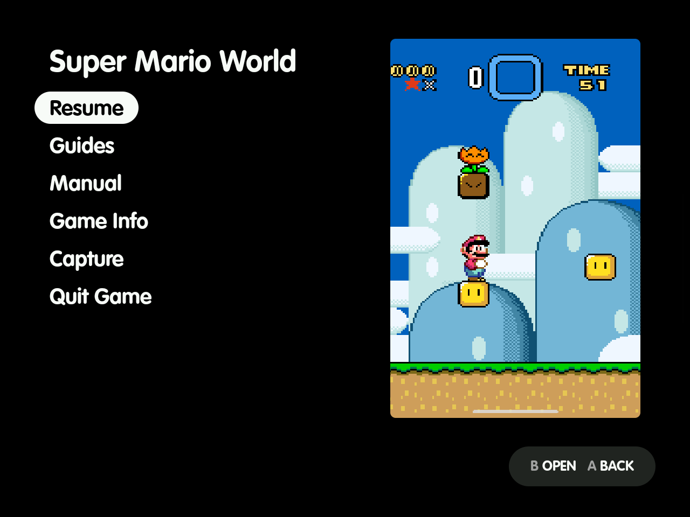
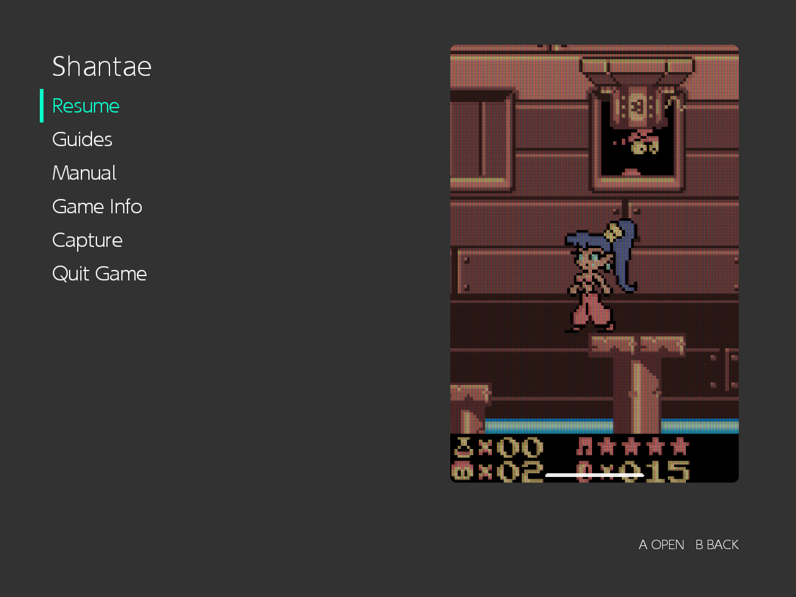
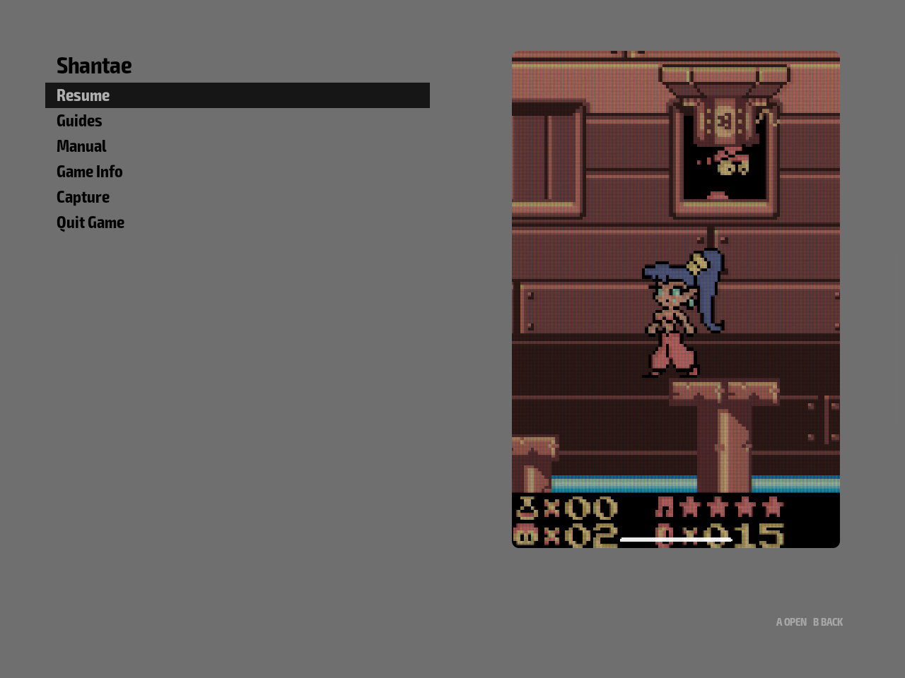
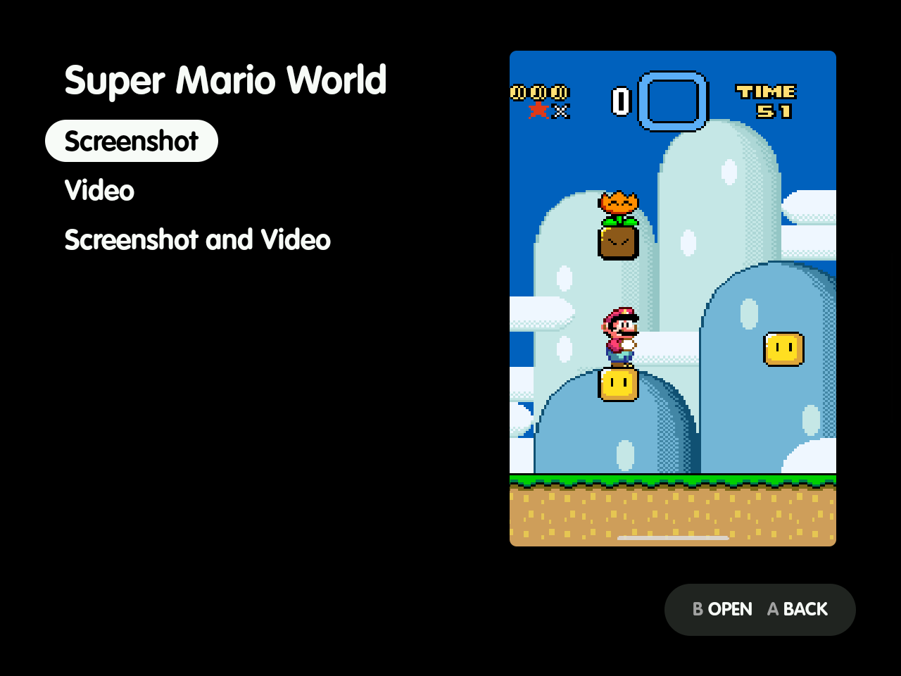
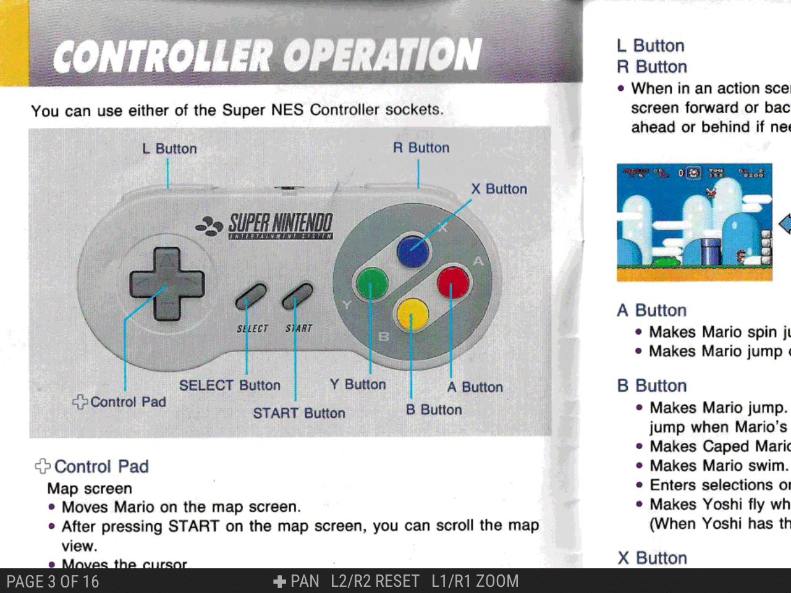

# ES-DE Overlay

[](https://github.com/clintonium-119/es-de-overlay/actions/workflows/ci.yml)
[](https://github.com/clintonium-119/es-de-overlay/actions/workflows/codeql.yml)
[](https://scorecard.dev/viewer/?uri=github.com/clintonium-119/es-de-overlay)
[](https://github.com/clintonium-119/es-de-overlay/releases/latest)
[](LICENSE)


An in-game menu for [ES-DE](https://es-de.org) on Android. Press the controller's **Back** button during a game you launched from ES-DE, and a menu opens over the game, drawn in your ES-DE theme's colours and font. It captures into ES-DE's media, opens the game's manual and guides, shows its ES-DE info and quits the game.

| MinUI Menu (Overlay) | Modern | Slate |
| --- | --- | --- |
|  |  |  |

The same menu under three ES-DE themes; the first is a [fork of minui-menu-es-de](https://github.com/clintonium-119/minui-menu-overlay-es-de). **Documentation:** [clintonium-119.github.io/es-de-overlay](https://clintonium-119.github.io/es-de-overlay/), including [how the look works](https://clintonium-119.github.io/es-de-overlay/theme.html).

## What it adds

| Capture | Manual | Guides |
| --- | --- | --- |
|  |  |  |
| Screenshots and clips saved into ES-DE's media under ES-DE's names, so they show in the gamelist. | The game's scraped manual, with ES-DE's own viewer controls: pages, zoom and pan. | Maps, walkthroughs and guides from VGMaps, StrategyWiki, GameFAQs and more, read offline. |

## Get it

Download `es-de-overlay-<version>.apk` from the [latest release](https://github.com/clintonium-119/es-de-overlay/releases/latest). Or add `https://github.com/clintonium-119/es-de-overlay` to [Obtainium](https://github.com/ImranR98/Obtainium), which keeps it up to date. It needs Android 13 or newer, [ES-DE](https://es-de.org) for Android and a controller with a Back button. It was developed and tested on a Retroid Pocket Nova with ES-DE 3.5.0.

## Set up

Open ES-DE Overlay, pick the ES-DE and ROMs folders, enable the permission rows and the Back button menu, then start the service. [Set up](https://clintonium-119.github.io/es-de-overlay/setup.html) goes through each row. [Shizuku](https://clintonium-119.github.io/es-de-overlay/shizuku.html) is optional; it lets Quit Game end games directly.

## Build from source

Needs JDK 17 and the Android SDK (platform 36).

```sh
JAVA_HOME=/usr/lib/jvm/java-17-openjdk ./gradlew testDebugUnitTest assembleDebug
adb install -r app/build/outputs/apk/debug/app-debug.apk
adb logcat -G 16M && adb logcat -s ESDEShot   # the app's debug log
```

## Safety

ES-DE Overlay asks for broad permissions. It captures the screen and game sound, holds the controller's Back button during games through an accessibility service, and draws over other apps. With Shizuku, it can also end other apps. [Privacy and safety](https://clintonium-119.github.io/es-de-overlay/privacy.html) lists what it can access and when it goes online. It has no analytics, accounts or ads.

ES-DE Overlay is written with an AI coding assistant and reviewed by its author. The code has been swept for the risks an app with these permissions carries. Every push runs the unit tests and Android Lint, and CodeQL and OpenSSF Scorecard scan the main branch (the badges above). It comes with no guarantees: use it at your own risk, as the MIT licence says. To report a security problem privately, see [SECURITY.md](SECURITY.md).

## Credits

Built for [ES-DE](https://es-de.org). The screenshots show a fork of Anthony Caccese's [minui-menu-es-de](https://github.com/anthonycaccese/minui-menu-es-de), a port of Shaun Inman's [MinUI](https://github.com/shauninman/MinUI). [Pixel Guide](https://github.com/rexmont/Pixel-Guide-Android) and [Pocket Codex](https://www.pocketcodex.app/) showed how useful game guides are on a handheld. The app bundles Mozilla's [Readability](https://github.com/mozilla/readability) and the [Shizuku API](https://github.com/RikkaApps/Shizuku-API). [Credits](https://clintonium-119.github.io/es-de-overlay/credits.html) has the full list with licences.

## Licence

[MIT](LICENSE).
