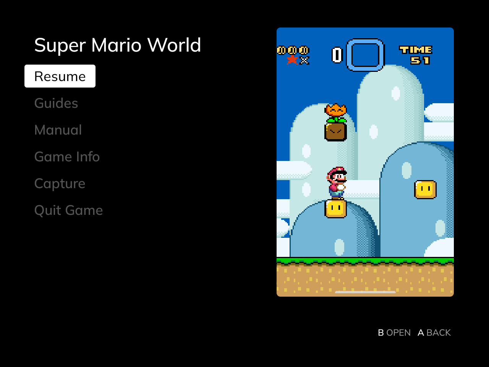
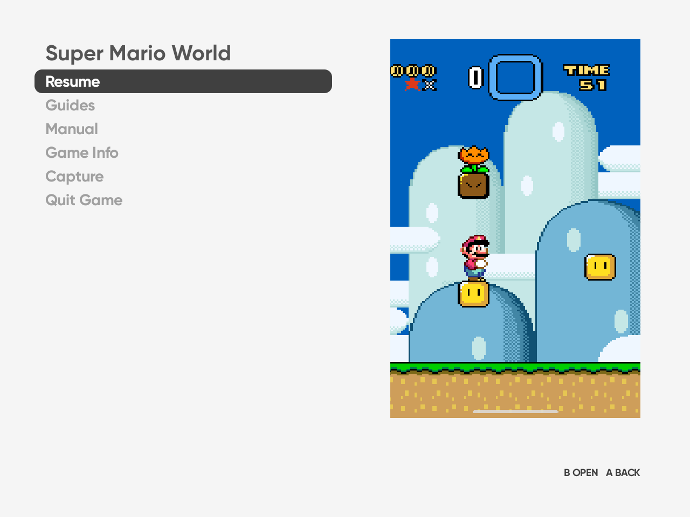
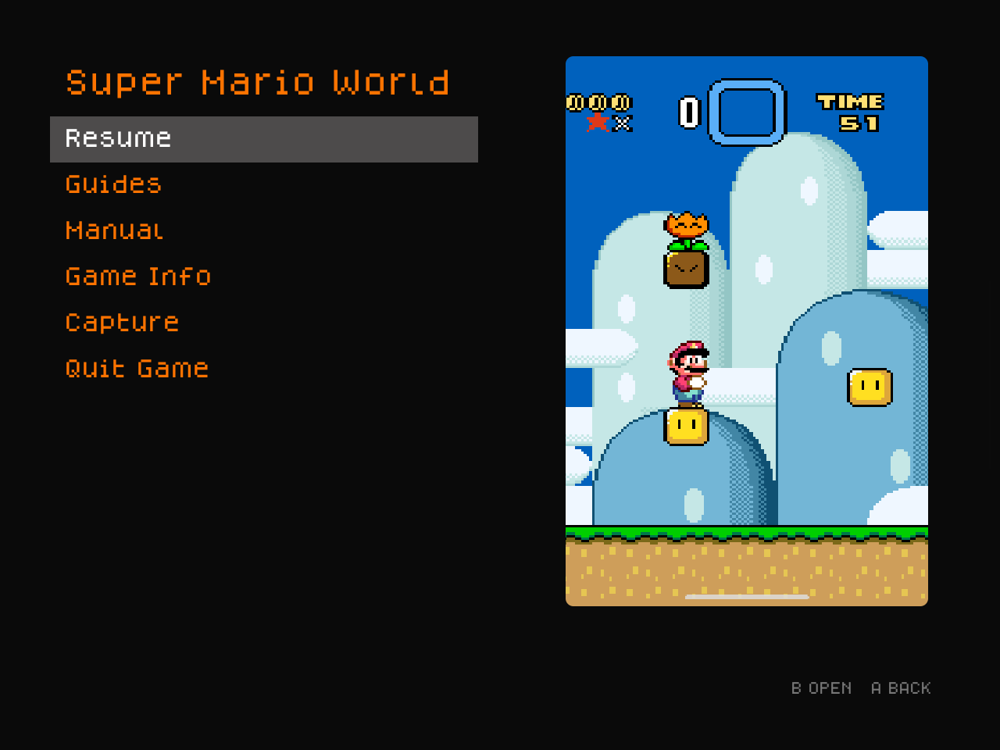
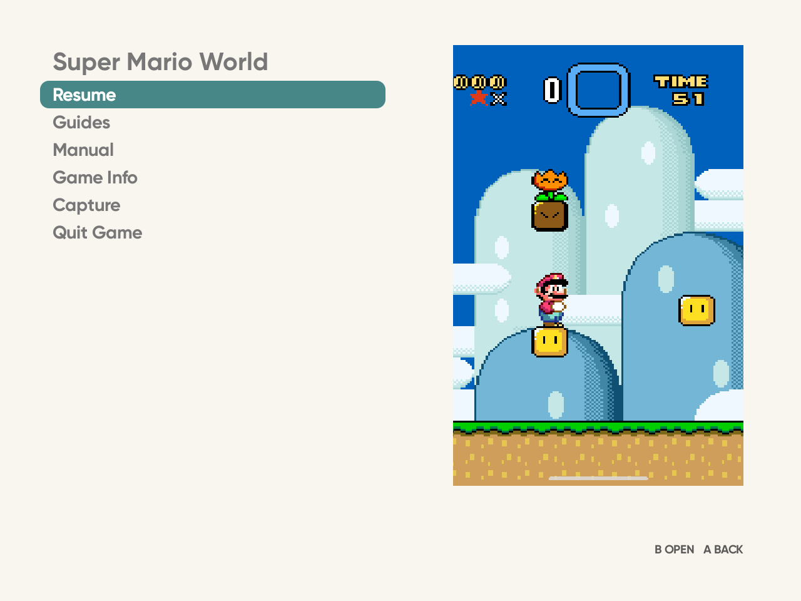
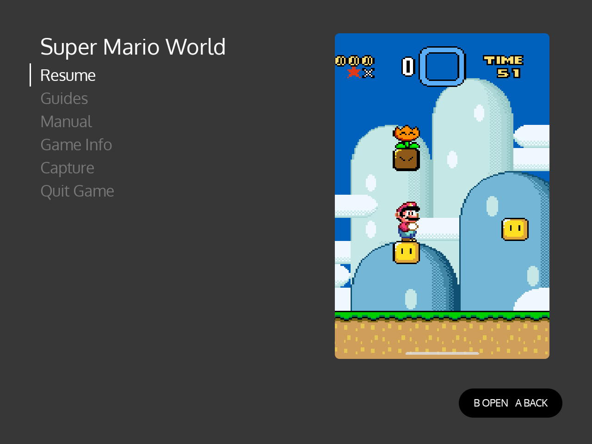
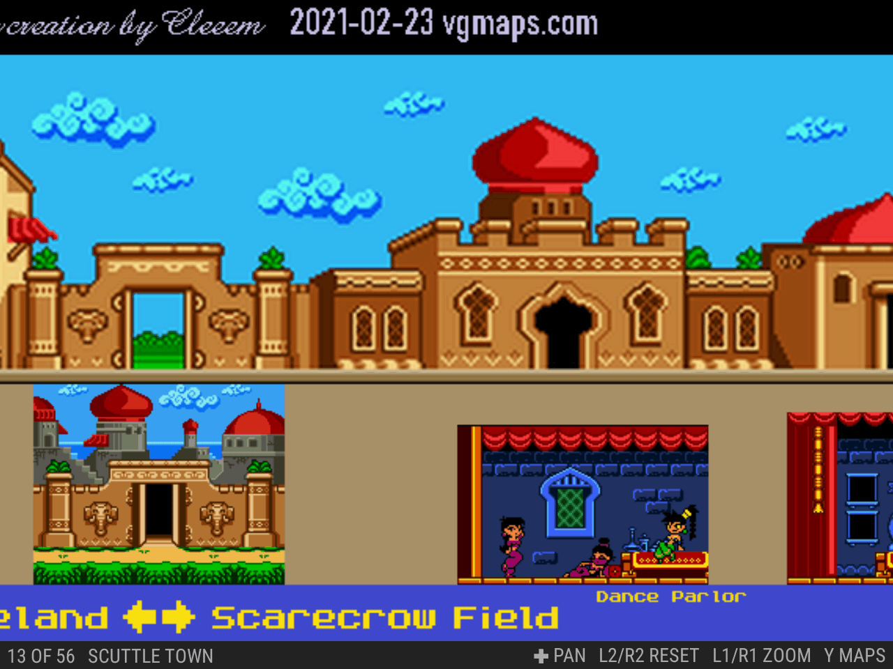

# ES-DE Overlay

[](https://github.com/clintonium-119/es-de-overlay/actions/workflows/ci.yml)
[](https://github.com/clintonium-119/es-de-overlay/actions/workflows/codeql.yml)
[](https://github.com/clintonium-119/es-de-overlay/releases/latest)
[](LICENSE)


ES-DE Overlay adds an in-game menu to [ES-DE](https://es-de.org) on Android. Press **Back** or **Menu** on your controller during a game you launched from ES-DE, and the menu opens over it in your ES-DE theme's colours and font. From it you can save a screenshot or clip straight into ES-DE's media, read the game's manual, find and read guides, see the game's ES-DE info, and quit.

Back is the Android Back button beside Home on Retroid and AYN handhelds. Menu is for controllers that have one.

**[Read the documentation →](https://clintonium-119.github.io/es-de-overlay/)**

| MinUI Menu (Overlay) | Art Book Next | Iconic |
| --- | --- | --- |
|  |  |  |
| **TechDweeb** | **Canvas** | **Linear** |
|  |  |  |

The same menu in six ES-DE themes. The first is a [fork of minui-menu-es-de](https://github.com/clintonium-119/minui-menu-overlay-es-de), and [Theme](https://clintonium-119.github.io/es-de-overlay/theme.html) explains how the app takes each theme's look.

## What it adds

| Capture | Manual | Guides |
| --- | --- | --- |
|  |  |  |
| Save screenshots and clips into ES-DE's media, named the way ES-DE expects, so they show up in the gamelist straight away. | Read the game's scraped manual with ES-DE's own viewer controls: pages, zoom and pan. | Save maps, walkthroughs and guides from VGMaps, StrategyWiki, GameFAQs and more, and read them offline. |

## Get it

You need:

- Android 13 or newer. The app is tested on Android 13 only.
- [ES-DE](https://es-de.org) for Android, set up with your games. The app was developed with ES-DE 3.5.0.
- A controller with a Back or Menu button.

To install it, either:

- download `es-de-overlay-<version>.apk` from the [latest release](https://github.com/clintonium-119/es-de-overlay/releases/latest) and open it on the device, or
- add `https://github.com/clintonium-119/es-de-overlay` to [Obtainium](https://github.com/ImranR98/Obtainium), which keeps it up to date.

The app was developed and tested on a Retroid Pocket Nova.

## Set up

Open ES-DE Overlay, pick your ES-DE and ROMs folders, grant the permissions it lists, and tap **Start Service**. Then press Back or Menu in a game. The [setup guide](https://clintonium-119.github.io/es-de-overlay/setup.html) walks you through it, says what each permission is for, and covers the optional settings, including [Shizuku](https://clintonium-119.github.io/es-de-overlay/shizuku.html) for quitting games directly.

## Build from source

You need JDK 17 and the Android SDK, platform 36.

```sh
./gradlew testDebugUnitTest assembleDebug
adb install -r app/build/outputs/apk/debug/app-debug.apk
adb logcat -G 16M && adb logcat -s ESDEShot   # the app's debug log
```

## Safety

ES-DE Overlay asks for broad permissions. It captures the screen and sound, intercepts the controller's Back or Menu button during games through an accessibility service, and draws over other apps. With Shizuku, it can also end other apps. [Privacy and safety](https://clintonium-119.github.io/es-de-overlay/privacy.html) lists what it can access and when it goes online. It adds no analytics, accounts or ads of its own.

ES-DE Overlay is written with an AI coding assistant and reviewed by its author. The code has been checked for the ways an app with these permissions could be misused, and each finding was fixed or accepted with a reason; [Privacy and safety](https://clintonium-119.github.io/es-de-overlay/privacy.html) says what was checked. Every push runs the unit tests and Android Lint, and CodeQL and OpenSSF Scorecard scan the main branch. There's no warranty (it's MIT-licensed), so use it at your own risk. To report a security problem privately, see [SECURITY.md](SECURITY.md).

[](https://scorecard.dev/viewer/?uri=github.com/clintonium-119/es-de-overlay)

OpenSSF Scorecard rates a repository's security practices. Several of its checks need a second maintainer reviewing each change or a repository with a longer history, so a new one-person project like this one scores lower on those.

## Credits

Built for [ES-DE](https://es-de.org). The screenshots show a fork of Anthony Caccese's [minui-menu-es-de](https://github.com/anthonycaccese/minui-menu-es-de), a port of Shaun Inman's [MinUI](https://github.com/shauninman/MinUI). [Pixel Guide](https://github.com/rexmont/Pixel-Guide-Android) and [Pocket Codex](https://www.pocketcodex.app/) showed how useful game guides are on a handheld. The app bundles Mozilla's [Readability](https://github.com/mozilla/readability) and the [Shizuku API](https://github.com/RikkaApps/Shizuku-API). [Credits](https://clintonium-119.github.io/es-de-overlay/credits.html) has the full list with licences.

## Licence

[MIT](LICENSE).
