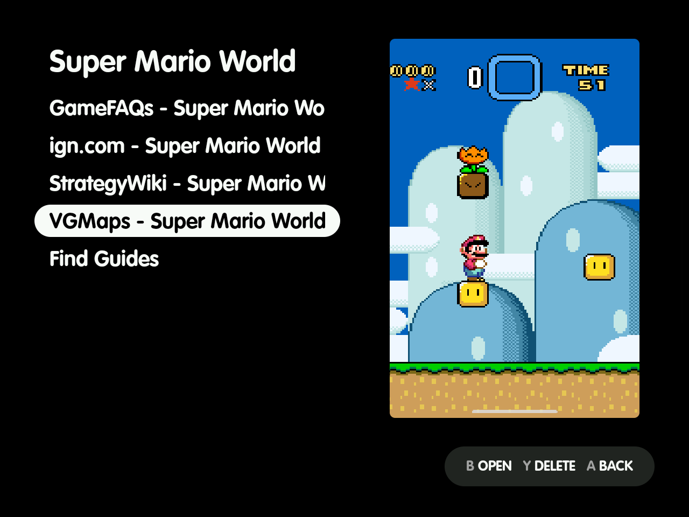
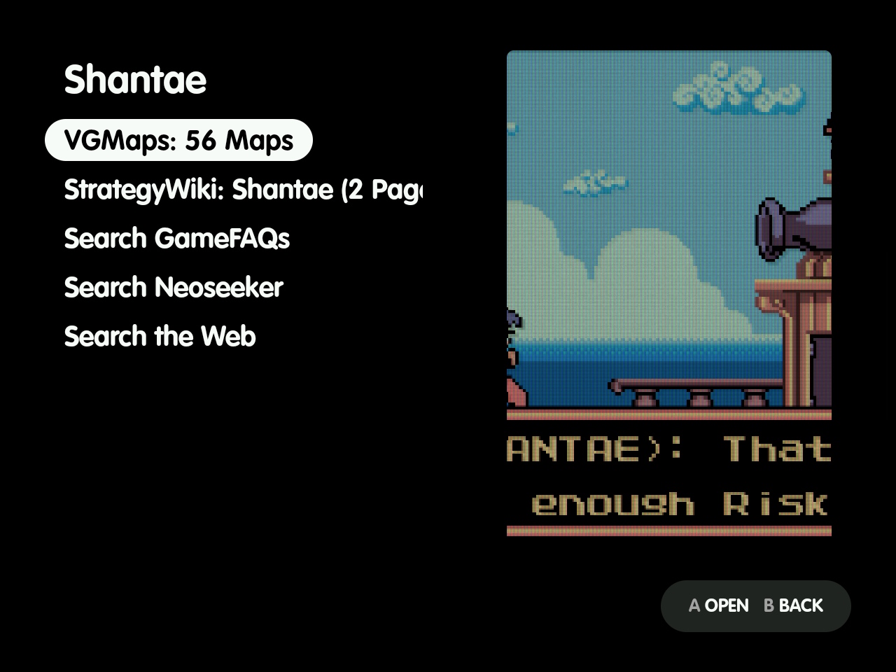
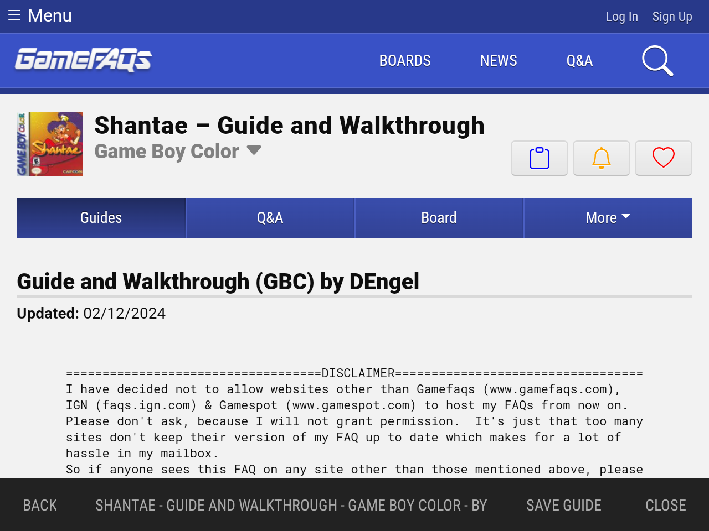
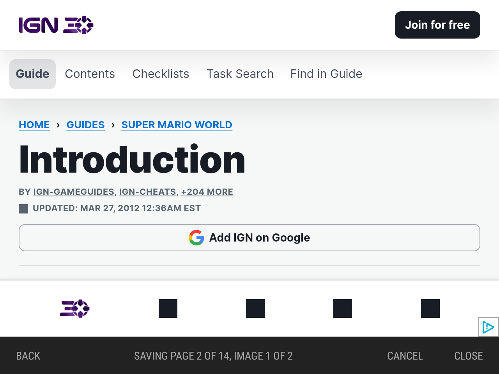
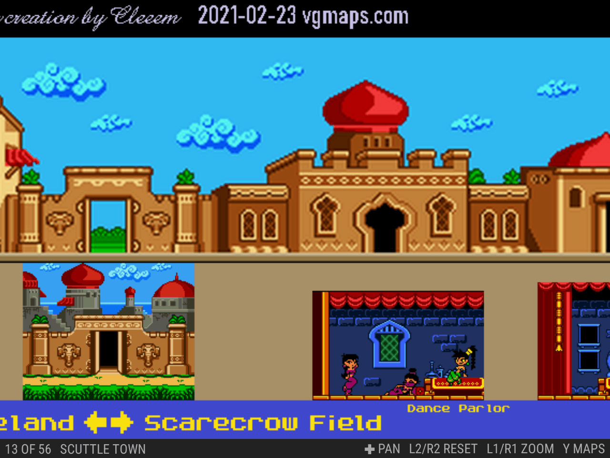
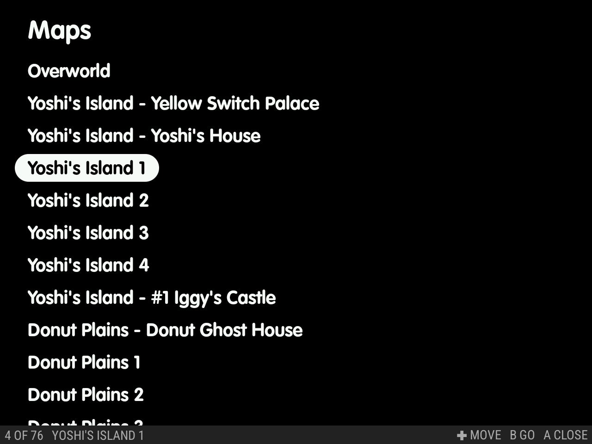
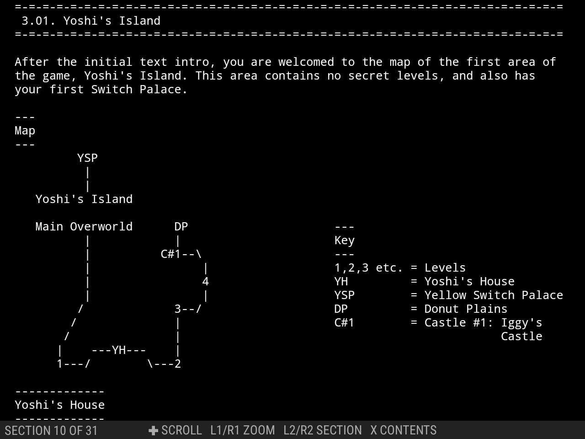
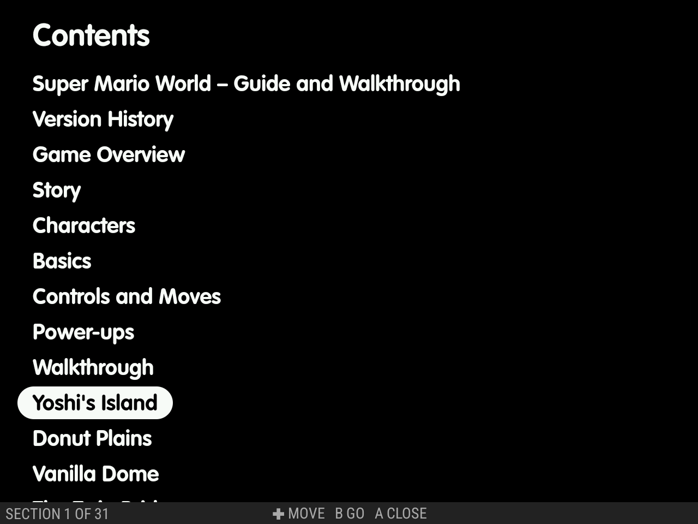

---
---

# Guides

**Guides** lists the game's guides by name, then **Find Guides**.

- Press **X** on a guide to delete it. You're asked to confirm: **Delete** removes it, and **Keep** or **B** leaves it.
- Guides and manuals reopen where you left off, including the zoom and text size, even after a restart.



## Find Guides

**Find Guides** checks VGMaps and StrategyWiki for the game and lists the ones that have it, for example `VGMaps: 76 Maps` and `StrategyWiki: Super Mario World (98 Pages)`.

- Pick one to save it. The menu shows the progress (**B** cancels and saves nothing), then opens the guide. From then on, the main menu shows Guides.
- Pick a source again to replace the saved file.
- Without a connection, the menu says `Couldn't reach the guide sources`.

Below those, Find Guides always lists **Search GameFAQs** and **Search Neoseeker**. For a Zelda game that ZeldaDungeon has a walkthrough for, it adds **ZeldaDungeon**. Last comes **Search the Web**, a DuckDuckGo search for "<game> guide". The app contacts these sites only when you pick one.



## The guide browser

Each site opens in a touch-controlled browser on top of the game, already searching for your game. ZeldaDungeon opens at the game's walkthrough.

- The bar has **Back**, the page title, **Save guide** on a guide's page, and **Close**.
- Tap a text field to bring up the keyboard.
- Your first visit to a site may show a security check. It usually clears by itself; sometimes you need to tap "Verify you are human".

Tap **Save guide** to save the guide you have open:

- A text guide saves at once.
- A guide split into pages saves by loading each page in turn in the same browser, at least 2 seconds apart. The bar shows the progress, such as `Saving page 3 of 8, image 12 of 40`.
- If a page shows a security check, the bar says `Clear the check to continue`, and the save waits until you've cleared it.
- **Cancel** stops and saves nothing.
- When it's done, the browser closes and the guide opens. Close the guide and you're back at the Guides list, with the new guide in it.
- If you close the browser without saving, you're back at the Find Guides list.

On any other site you browse to, **Save guide** appears on article-style pages, judged by Readability, the code behind Firefox's Reader View. It saves the page's main content with its images, each at the largest size the page lists. A page that's mostly pictures, such as a page of maps, keeps them with their captions.

If the guide runs over several pages, Save guide lists them first so you can choose which to include:

- Every page starts ticked, except ones that look like the site's own pages (contributors, edit, log in).
- Untick or tick any and tap **Save guide** again, or tap **Back** to return to the page.
- If the guide uses Next links, Save guide follows them one page at a time, up to 50 pages.
- Pages that turn out not to exist are skipped.

The site's own images, such as its logo, are left out. Links to YouTube videos are kept.





## The viewer

The viewer works like ES-DE's own manual viewer:

| | Zoomed out | Zoomed in |
|---|---|---|
| D-pad left/right | previous/next page | pan |
| D-pad up/down | — | pan |
| L1 / R1 | zoom out / in | zoom out / in |
| L2 / R2 | first / last page | reset the zoom |
| Y | maps list (CBZ) | maps list (CBZ) |
| B | close | close |

**Maps (CBZ):**

- The bar shows the page's number and name, for example `3 OF 9   TAIL CAVE`.
- Press **Y** to list the maps by name, with the current one picked. The D-pad moves, L1/R1 move a screenful, L2/R2 go to the first and last map, **A** jumps to the map, and **B** or **Y** closes the list.

**Saved web guides (`.html`) and text guides (`.txt`):**

- Scroll with the D-pad. Left/right move a page at a time.
- L1/R1 change the text size, and L2/R2 move between sections. Text guides are split into sections at their headings.
- Above 100 %, text guides don't re-wrap, because that would break their ASCII art. Use left/right to pan instead (the bar shows `✚ PAN`).
- Press **Y** to show the contents over the guide, with the section in view picked. It works like the maps list.
- When a picture is in view, the bar shows `A IMAGE`. Press **A**, or tap the picture, to open it in the viewer above. There, left/right turn through the guide's other pictures, and **B** takes you back to the guide where you were.
- When a link to a YouTube video is in view, the bar shows `A VIDEO`. Press **A**, or tap the link, to play it in the guide browser over the guide. There, **A** pauses (the first press unmutes), D-pad left/right skip ten seconds, and **B** takes you back to the guide where you were.
- Otherwise **B** goes back through any links you followed, then closes the guide.









## Where guides are kept

Guides live next to ES-DE's other media, named like the ROM. Add your own there, or let **Find Guides** save them:

```
<ES-DE>/downloaded_media/<system>/guides/<ROM subfolders>/<ROM name>.<ext>
<ES-DE>/downloaded_media/<system>/guides/<ROM subfolders>/<ROM name>/<any name>.<ext>
```

- The folder form holds several guides.
- Supported:
  - `pdf`;
  - `txt` (UTF-8; ASCII art keeps its columns);
  - `png`, `jpg`/`jpeg` (large maps are decoded a region at a time);
  - `cbz`;
  - `html`.
- Not supported: `cbr`.
- A ROM that is a folder (such as `dig.scummvm`) keeps its whole name, as for ES-DE's own media.

Find Guides saves into the folder form, for example:

```
<ES-DE>/downloaded_media/snes/guides/Super Mario World/VGMaps - Super Mario World.cbz
<ES-DE>/downloaded_media/snes/guides/Super Metroid/StrategyWiki - Super Metroid.html
<ES-DE>/downloaded_media/snes/guides/Super Mario World/GameFAQs - Super Mario World – Guide and Walkthrough by Crazyreyn.html
```

What each kind of save holds:

- **VGMaps:** one CBZ of the game's maps in the atlas's order, each named as the atlas names it (`003 Tail Cave.png`).
- **StrategyWiki:** one HTML file, with a contents list, one section per wiki page, its images inside the file, and the source and licence (CC BY-SA 4.0) at the end.
- **From the browser:** the same kind of HTML file. A text guide is kept as fixed-width text, and a guide in pages gets one section per page with its images inside.

Saved guides leave out site scripts, ads and comments, and end with the source page and author. Guides belong to their authors, so save them for your own reading only. The viewer shows saved guides offline in your theme's colours and font. Opened anywhere else, they're plain web pages.

## Manage Guides

In settings, **Saved guides → Manage Guides** lists every saved guide by game, with the total at the top. Each game shows its ES-DE name, system, guide count, size and when you last played it.

- Search finds a game by name; **✕** clears the search.
- **Size** (largest first), **Last Played** (oldest first, never-played before that) and **Name** sort the list.
- A game whose ROM is no longer in the ROMs folder says *ROM missing*.
- Open a game to see its guides and their sizes. **Delete** removes one guide and **Delete All** removes all of them, each after you confirm (**Keep** leaves them). Deleting a game's last guide also removes its empty `<ROM name>/` folder.
- The screen reads the guides from `downloaded_media` each time you open it.
