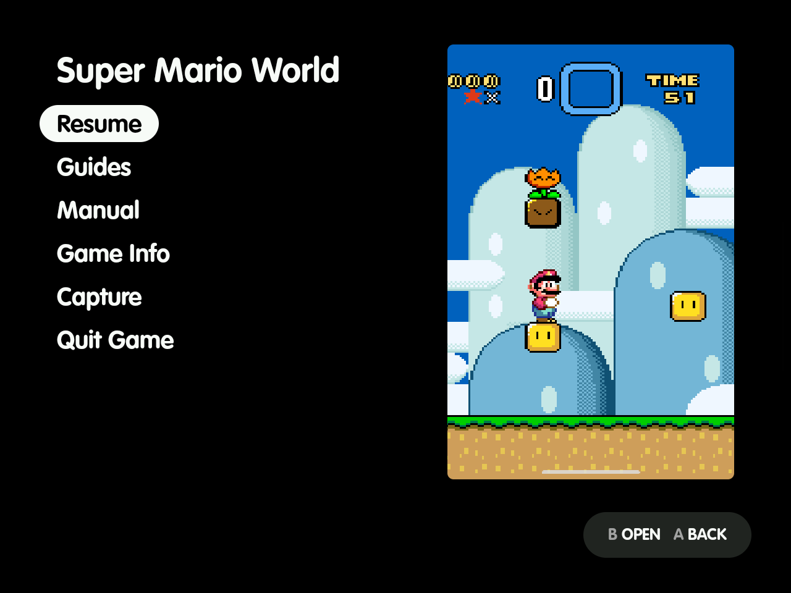
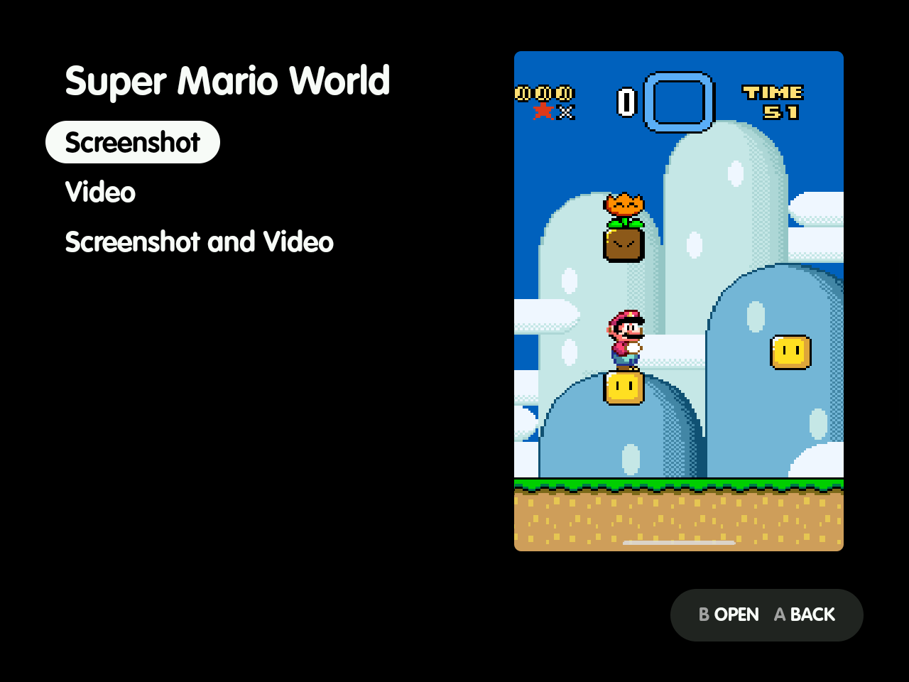
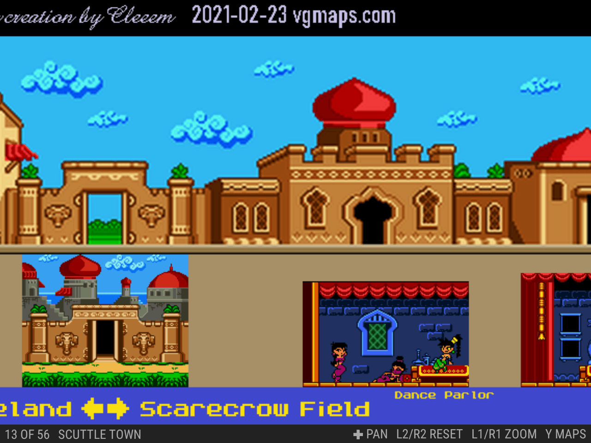
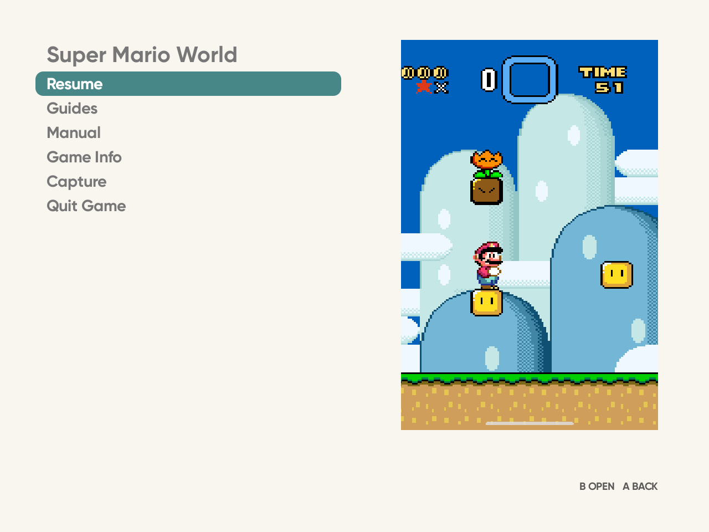
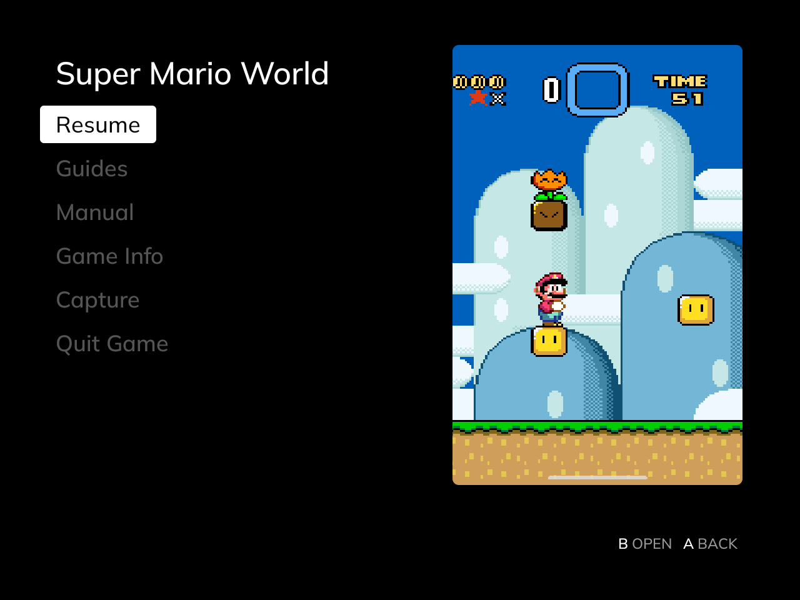
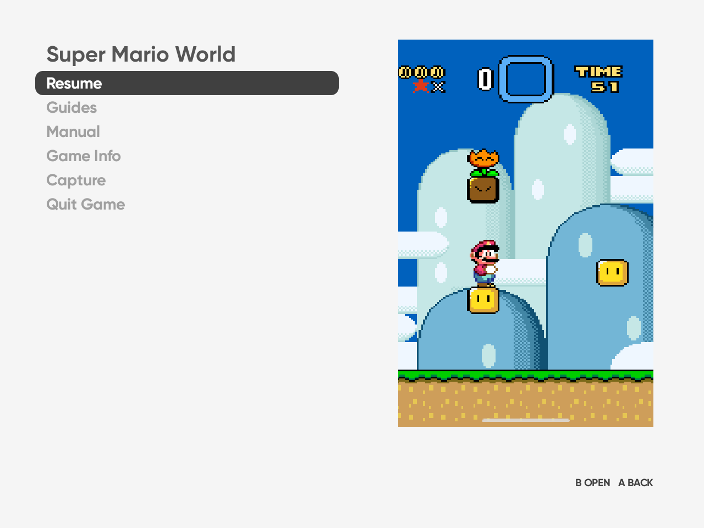
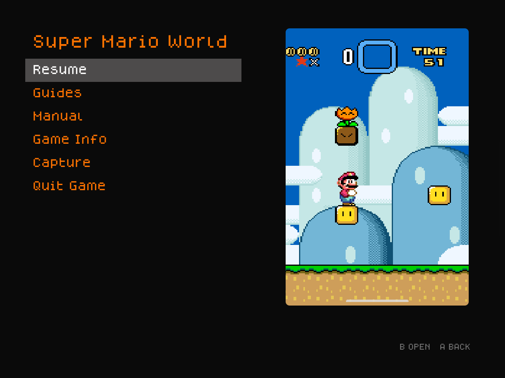
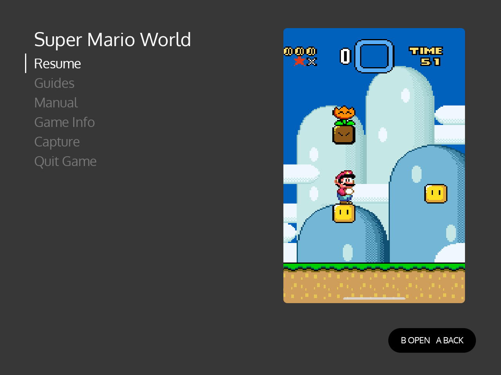

# ES-DE Overlay

<h1>{{ page.title }}</h1>

An in-game menu for [ES-DE](https://es-de.org) on Android. Press **Back** or **Menu** on your controller during a game you launched from ES-DE, and a menu opens over it. It looks like part of ES-DE: the same layout as a gamelist, in your theme's colours and font.

[Get it](#get-it){: .button} [Set up](setup.md){: .button .outline}
{: .actions}

## What it does

**Captures straight into ES-DE.** Save a screenshot, a clip or both. They go into ES-DE's media folders, named the way ES-DE expects, so they show up in the gamelist straight away. Turn on **Use system screenshots as game images** and the system screenshots you take during a game are saved there too.

**Manuals and guides in the game.** Read the game's manual, or any guide you've saved next to ES-DE's media. **Find Guides** downloads maps from VGMaps and walkthroughs from StrategyWiki, and can save guides from GameFAQs and other sites to read offline. The viewer works like ES-DE's own manual viewer.

**Your theme's look.** The menu, the guide viewer and the browser take their colours and font from your ES-DE theme. Change the theme in ES-DE and the app follows from the next game you start.

You can also see the game's ES-DE info and quit the game from the menu. [Use](use.md) covers every feature, and [Theme](theme.md) how the look works.

## It follows your theme

There's no per-theme setup: the app reads each theme's own files. [Theme](theme.md) shows them beside ES-DE's gamelist.

<figure><figcaption>MinUI Menu (Overlay)</figcaption></figure>
<figure><figcaption>Art Book Next</figcaption></figure>
<figure><figcaption>Iconic</figcaption></figure>
<figure><figcaption>TechDweeb</figcaption></figure>
<figure><figcaption>Canvas</figcaption></figure>
<figure><figcaption>Linear</figcaption></figure>

## What you need

- Android 13 or newer; tested on Android 13 only.
- [ES-DE](https://es-de.org) for Android, set up with your games. The app was developed with ES-DE 3.5.0.
- A controller with a Back or Menu button: the Android Back button beside Home on Retroid and AYN handhelds, or Menu on controllers that have one.

The app was developed and tested on a Retroid Pocket Nova. Some of what it does depends on the device's firmware, and [Known limitations](limitations.md) says where.

## Get it

- **From GitHub Releases:** download `es-de-overlay-<version>.apk` from the [latest release](https://github.com/clintonium-119/es-de-overlay/releases/latest) and open it on the device.
- **With [Obtainium](https://github.com/ImranR98/Obtainium):** add the app by its repository URL, `https://github.com/clintonium-119/es-de-overlay`. Obtainium then installs new releases as they come out.

Then follow [Set up](setup.md). You can also [build it yourself](setup.md#build-from-source).

## Tested on

| Device | Android | ES-DE | Result |
| --- | --- | --- | --- |
| Retroid Pocket Nova | 13 | 3.5.0 | Every feature, with RetroArch and Eden games. |

Tried it on another device? [Open an issue](https://github.com/clintonium-119/es-de-overlay/issues) with the device, its Android and ES-DE versions, and what worked and what didn't.

## Safety

ES-DE Overlay asks for broad permissions. [Privacy and safety](privacy.md) lists what it can access, when it goes online and how it was checked. There's no warranty, so use it at your own risk.
