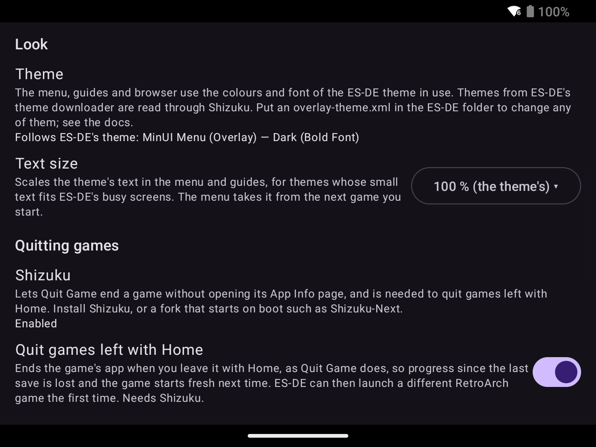

---
---

# Set up

## Install

Download `es-de-overlay-<version>.apk` from the [latest release](https://github.com/clintonium-119/es-de-overlay/releases/latest) and open it on the device. Android asks once to allow installs from the app that opened it, such as your browser or file manager. Or add `https://github.com/clintonium-119/es-de-overlay` to [Obtainium](https://github.com/ImranR98/Obtainium), which installs the app and its updates for you.

## Get the menu working

Open **ES-DE Overlay** (ES-DE also lists it under Android Apps), then:

1. Pick your folders, under **Folders**.
   - **ES-DE data folder → Set Folder**: the ES-DE folder that holds `downloaded_media`, `gamelists` and `logs`. Open the SD card or internal storage, choose `ES-DE`, then *Use this folder* and *Allow*. If the row says *No ES-DE log here; set the ES-DE folder*, you picked the wrong folder: the right one contains `logs/es_log.txt`.
   - **ROMs folder → Set Folder**: the folder that holds your system folders (`snes`, `gbc`…). Android won't let an app have a whole SD card, which is why you pick the two folders separately. If the row says *No ES-DE system folders here*, none of the folders in it matches a system ES-DE has a gamelist for.
2. Grant the permissions, under **Permissions** at the bottom. Tap **Enable** on each row you want, using the table below to choose. A row says *Enabled* once it's on. If Android has stopped showing a permission's prompt (after you deny it twice), **Enable** opens the app's App Info page instead, where you can grant it by hand.

   | Row in settings | Needed for | Kind |
   | --- | --- | --- |
   | Display over other apps | The menu, viewer and browser windows | Required |
   | Usage access | Knowing which app is in front | Required |
   | Back button menu (accessibility service) | Opening the menu from the controller; also turning the screen off when idle, and Quit Game without Shizuku | Required |
   | Notifications | Capture results, the start-after-boot offer | Recommended |
   | Ignore battery optimization | Keeping the service alive in the background; Android can still end it when memory runs short | Recommended |
   | Game sound in clips | Sound in video clips; the microphone is not used | Optional |
   | Read screenshots | Filing Power + Volume down screenshots under the game. Leave it off if you take screenshots for other reasons: with the default **Replace**, each one replaces the game's image | Optional |

   **Back button menu → Enable** opens Android's accessibility settings, where you turn on *ES-DE Overlay*.
   - This is an accessibility service. Android shows it every controller button press. It passes them all through except Back and Menu, and takes those only during a game ES-DE launched, a capture or the open menu.
   - For Quit Game without Shizuku, it presses Force stop on the game's App Info page in Settings.
   - Android 13 can refuse to turn on an accessibility service for an app installed from a browser or file manager, with a *Restricted setting* message. To get past it, open App Info for ES-DE Overlay, tap the menu at the top right, tap **Allow restricted settings**, then turn the service on. See [Google's help page](https://support.google.com/android/answer/12623953).
3. Under **Service** at the top, tap **Start Service**, then **Start now** on Android's screen-capture prompt. The button then says **Stop Service**. Android asks once for permission to capture the screen, and that lasts until the service stops or the device restarts.
4. Try it: launch a game from ES-DE and press Back or Menu on the controller. The menu opens over the game, and [Use](use.md) goes through it.

## Optional settings

Each of these is a section of the settings screen, in the order they appear.

### Start after boot and the quick settings tile

Under **Service**:

- **Offer to start after boot** posts a *Tap to start ES-DE Overlay* notification after a restart. One tap brings up Android's screen-capture prompt, which nobody can accept for you at boot. It needs the Notifications permission.
- **Quick settings tile → Add** puts an *ES-DE Overlay* on/off tile in the swipe-down shade, and the row says *Added* afterwards. Turning the tile on shows the screen-capture prompt, then returns you to whatever you were doing.

### Capture

- **Screenshot media type** lists ES-DE's image types (default Screenshots). Pick the one your theme shows in the gamelist, so captures show there and in the menu.
- **Clip length** runs from 5 to 60 s in 5 s steps (default 15 s).
- **If the media file already exists**: **Replace** (the default) saves over it, and **Skip** keeps it and drops the new capture.

### Screen off when idle

ES-DE keeps the screen on while it's in front, even behind its screensaver, so a handheld left in ES-DE stays lit until the battery runs out. Under **Screen**, **Turn the screen off when ES-DE is idle** locks the screen like the power button once ES-DE's screensaver has run for **After the screensaver has run for** (At once, or 1 to 30 min; default 9).

- It's on by default when ES-DE is your Home app.
- ES-DE has to report its screensaver: in ES-DE's *Other Settings*, turn on *Custom Event Scripts* and *Debug Mode*. The row tells you while they're off.
- The accessibility service behind **Back button menu** does the locking, so it keeps working with the service stopped. It also needs **Usage access**.

### Look and quitting games



- Under **Look**, the Theme row shows which ES-DE theme the app follows. **Text size** scales the theme's text in the menu and guides. The menu takes it from the next game you start. See [Theme](theme.md).
- Under **Quitting games**, set up [Shizuku](shizuku.md), then tap **Allow** on the **Shizuku** row. With Shizuku, Quit Game ends a game without showing its App Info page, and you can turn on **Quit games left with Home**.

### Manage Guides

Under **Guides**, once the ES-DE folder is set, **Saved guides → Manage Guides** lists the guides you've saved, by game, and deletes the ones you no longer need. See [Manage Guides](use.md#manage-guides).

## Updating and uninstalling

- An update from one release to the next keeps your settings, so you don't need to uninstall. Afterwards, start the service again: Android drops the screen-capture permission whenever the service restarts.
- A build of your own is signed with a different key from the release APK, so Android won't install one over the other. Uninstall first, then set the app up again, because uninstalling clears its settings.
- To uninstall, turn off *ES-DE Overlay* in Android's accessibility settings first, then uninstall it like any app. Your captures and saved guides stay in `downloaded_media`.

## Build from source

Needs JDK 17 and the Android SDK, platform 36.

```sh
./gradlew testDebugUnitTest assembleDebug
adb install -r app/build/outputs/apk/debug/app-debug.apk
```
