---
---

# Theme

## The look follows your ES-DE theme

The menu, the guide viewer and the guide browser take their colours and font from your current ES-DE theme. They also follow the variant, colour scheme, font size and aspect ratio you set in ES-DE. Each part comes from a part of the theme's gamelist:

- the rows and the cursor from its text list;
- guide text from its game description text;
- the help pill from its help prompts;
- the background from its background colour (or, for a wallpaper image, the image's average colour).

The app borrows colours and fonts only. The layout is its own, and it doesn't draw the theme's images. Change the theme in ES-DE and the app follows from the next game you start.

Six themes, each with ES-DE's own gamelist on the left and the app's menu on the right:

| ES-DE's gamelist | The app's menu |
| --- | --- |
| 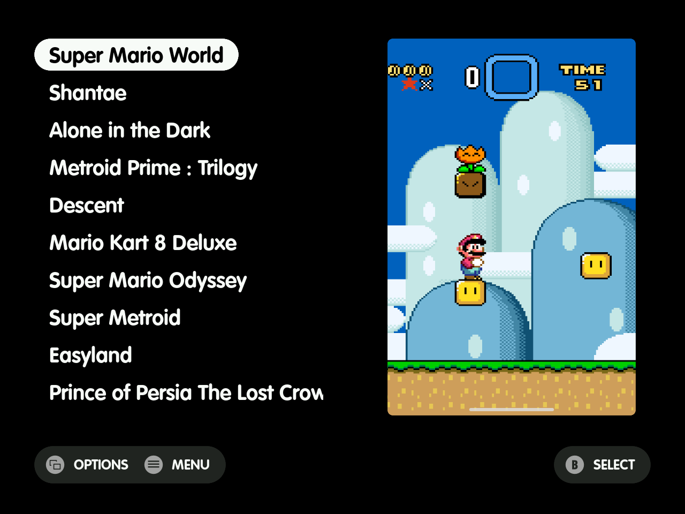 | 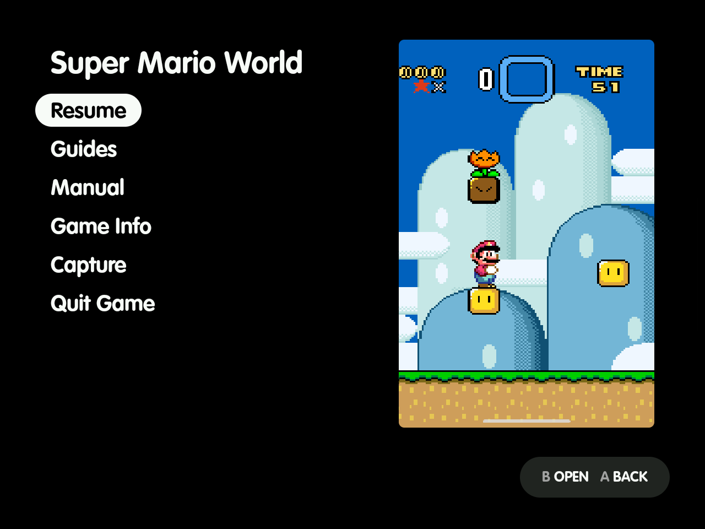 |
| 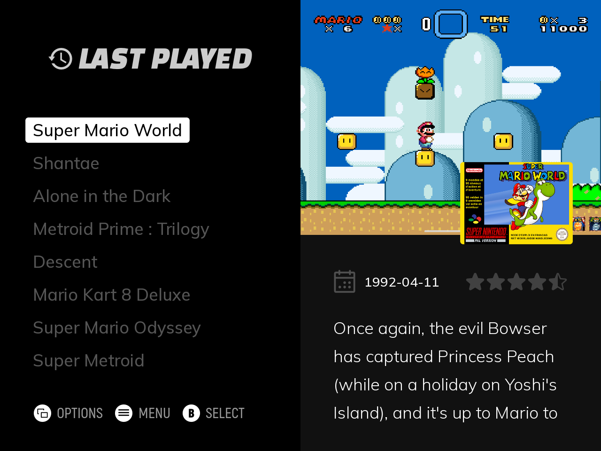 | 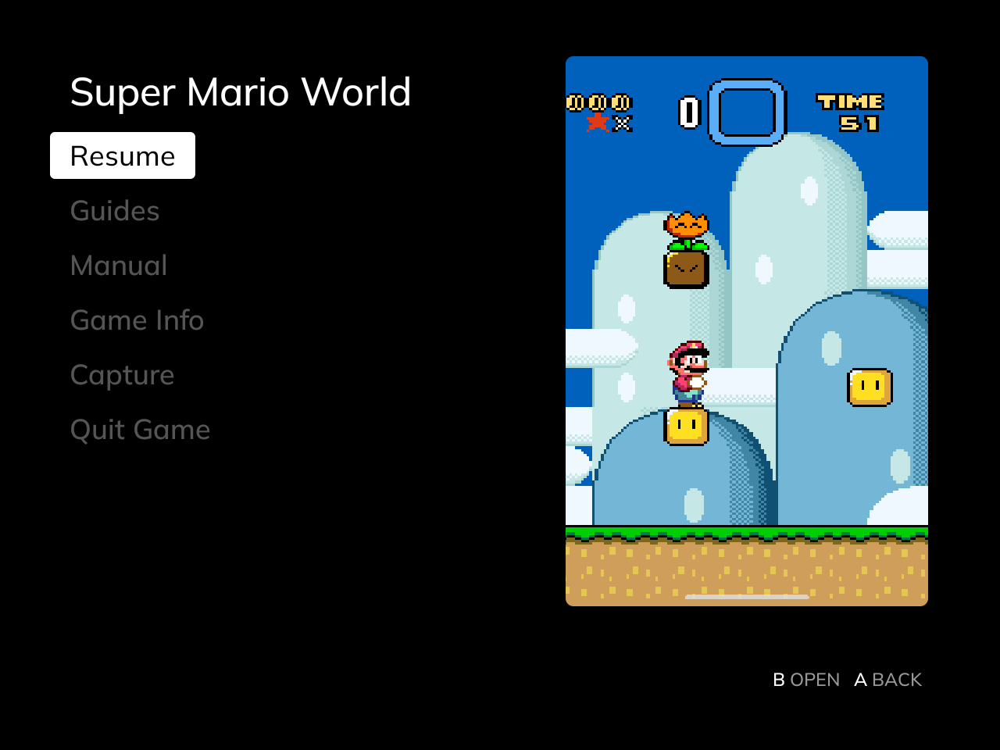 |
| 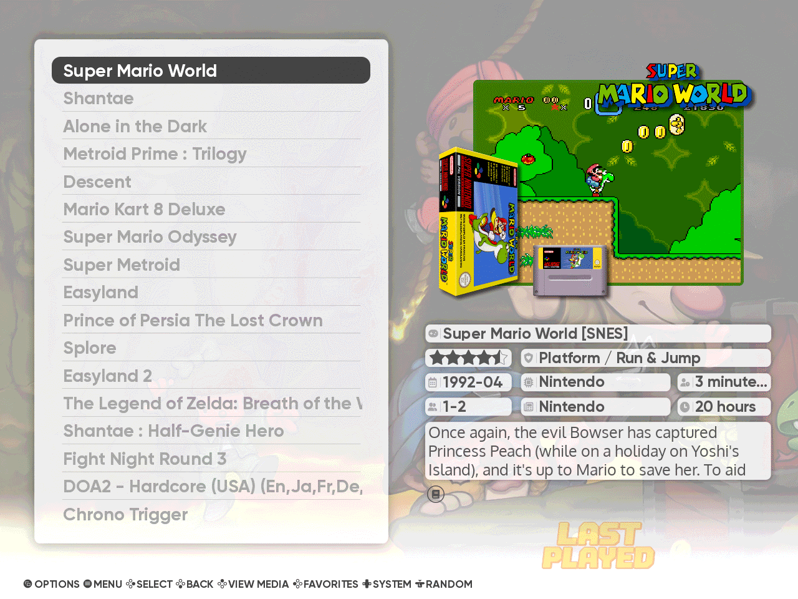 | 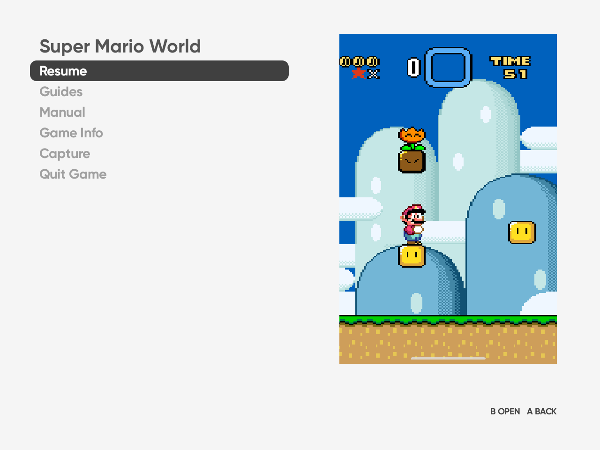 |
| 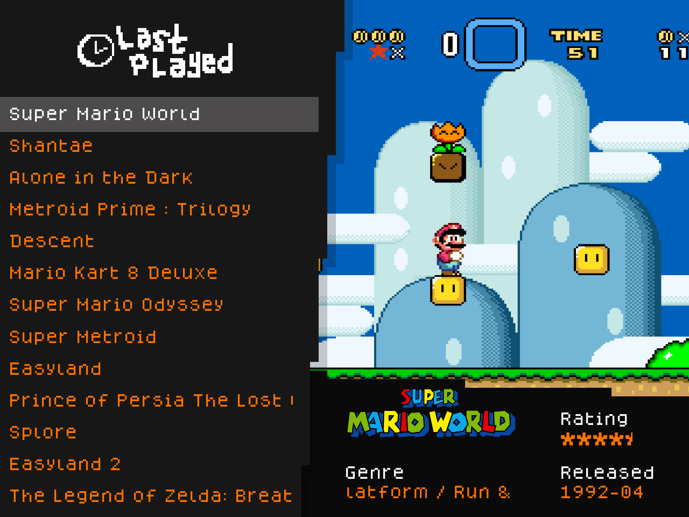 | 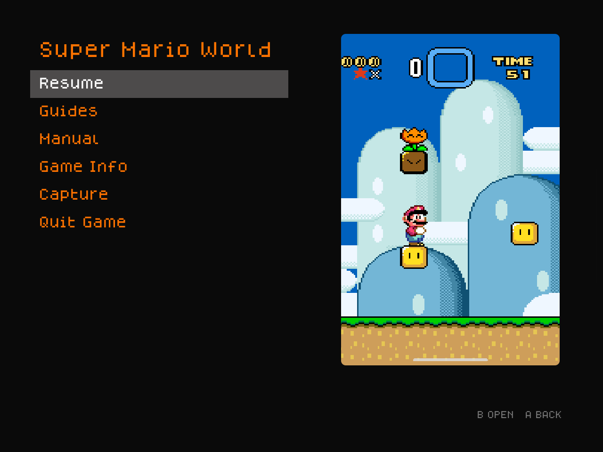 |
| 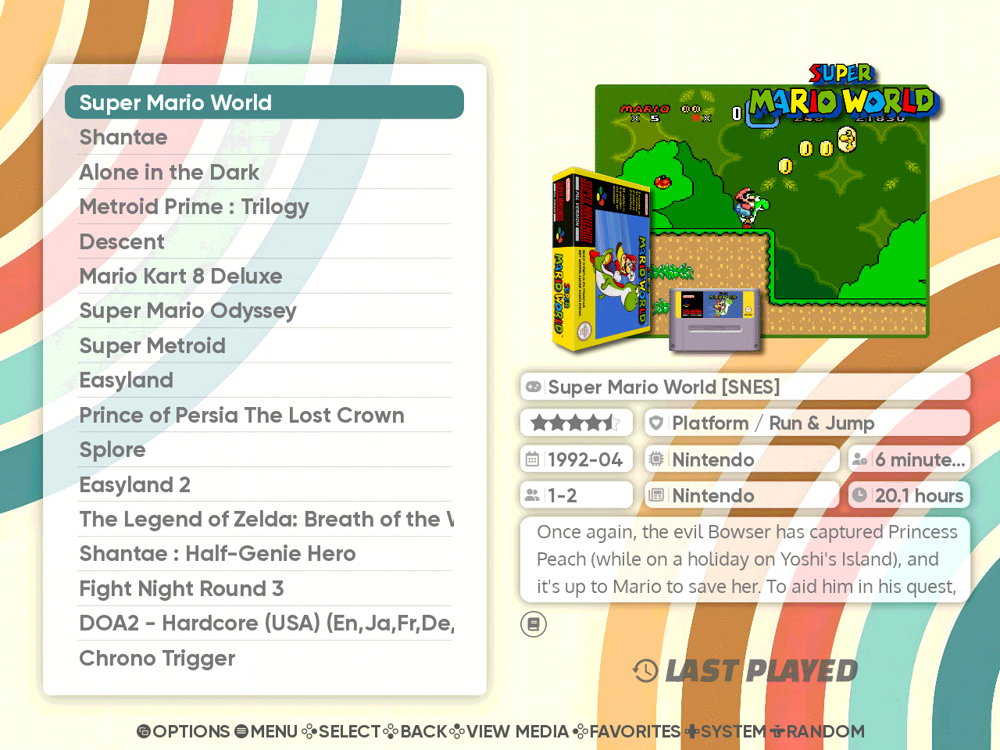 | 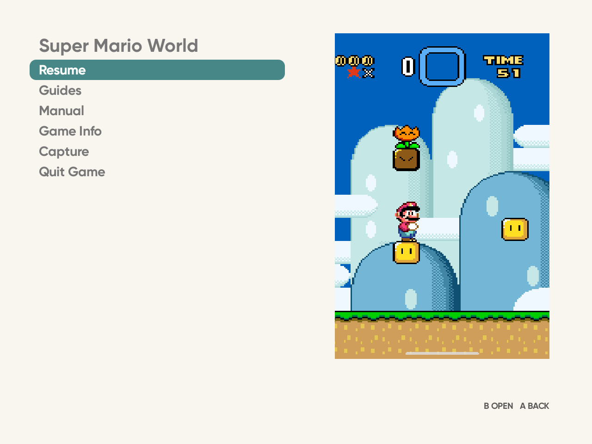 |
| 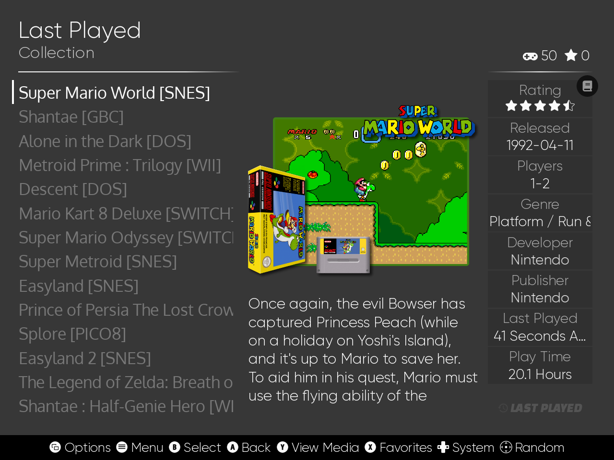 | 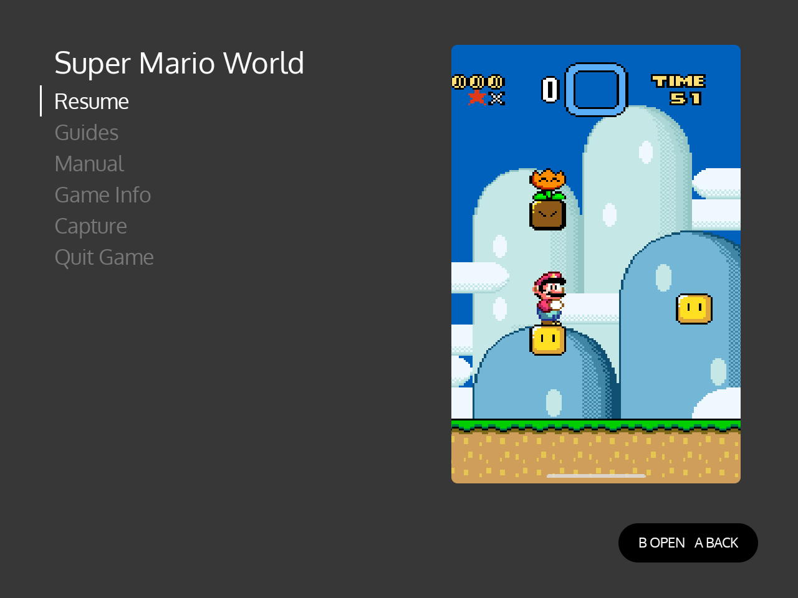 |

## Where the app reads the theme from

- **Themes in `ES-DE/themes/`**: any theme there works.
- **Themes from ES-DE's theme downloader**: these live in ES-DE's own app storage, which other apps can't read. The app reads them through [Shizuku](shizuku.md), copying a theme's XML, font and SVG files when a game starts after the theme changed.
  - Without Shizuku, copy the theme's folder from `Android/data/org.es_de.frontend/files/themes/` into `ES-DE/themes/`. Do it from a computer over USB, for example, because Android keeps most file managers out of that folder.
  - Copy it again after the theme updates.
- **Themes built into ES-DE, such as Linear**: read from ES-DE's app, so their colour scheme and fonts follow too.

If ES-DE itself can't be read, the app uses a default look in Linear's dark colours with the system font.

## The Look settings

In ES-DE Overlay's settings, under **Look**:

- **Theme** names the theme and colour scheme the app follows. If it has fallen back to the default look, it says so and why, and it starts with `overlay-theme.xml over` when an `overlay-theme.xml` is applied.
- **Text size** scales the theme's text in the menu and guides, from 90 % to 200 %. It's useful when a theme's text is too small to read comfortably in the menu. The menu takes it from the next game you start.

## overlay-theme.xml

To change any part of the look, put an `overlay-theme.xml` in the ES-DE folder, the one that holds `downloaded_media`. It overrides only the values it names; the rest still follow the theme:

```xml
<overlay>
    <background>102030</background>
    <selectedText>FFFFFF</selectedText>
</overlay>
```

- A value that doesn't parse is ignored, and so is a key not in the table below.
- Changes show from the next game ES-DE starts.
- Colours are written as ES-DE writes them: `RRGGBB`, or `RRGGBBAA` with transparency.
- Sizes are fractions of the screen, so `0.04` is 4 %.

| Key | What it sets | Value |
| --- | --- | --- |
| `background` | The background of the menu, the viewer and the browser | colour |
| `text` | The rows' text | colour |
| `selectedText` | The selected row's text | colour |
| `selectedBackground` | The cursor's pill, as wide as the selected row's text | colour |
| `selectedCornerRadius` | The pill's corners | fraction of the screen width |
| `selector` | The cursor's bar, under the pill | colour |
| `selectorWidth` | The bar's width. Below `0.05` it's a thin bar at the row's left, like Linear's; wider, or left out, the bar covers the row | fraction of the screen width |
| `selectorCornerRadius` | The bar's corners | fraction of the row's height |
| `helpBackground` | The help pill's background | colour |
| `helpIcon` | The help pill's button icons | colour |
| `helpText` | The help pill's text | colour |
| `fontPath` | The rows' font, a TTF or OTF file | path below the ES-DE folder, e.g. `fonts/list.ttf` |
| `fontSize` | The rows' text size | fraction of the screen height |
| `lineSpacing` | The rows' line spacing | multiple of `fontSize` |
| `bodyText` | Guide text | colour |
| `bodyFontPath` | Guide text's font | path below the ES-DE folder |
| `bodyFontSize` | Guide text's size | fraction of the screen height |
| `bodyLineSpacing` | Guide text's line spacing | multiple of `bodyFontSize` |
| `artCornerRadius` | The game art's corners | fraction of the screen width |
| `textScale` | Both text sizes, after the values above; the **Text size** setting then applies on top | percentage, e.g. `125` |

Font paths can't start with `/` or contain `..`. A path into a theme's folder works too, e.g. `themes/<theme>/<font file>`.

Here is an example that sets every key. You can also [download it](overlay-theme.example.xml):

```xml

```

## The theme in the screenshots

The screenshots use **[MinUI Menu (Overlay)](https://github.com/clintonium-119/minui-menu-overlay-es-de)**. It's a fork of Anthony Caccese's [minui-menu-es-de](https://github.com/anthonycaccese/minui-menu-es-de), itself a port of Shaun Inman's MinUI menu. The fork changes:

- **List spacing:** tighter at font size Small, so ten whole rows fill the list.
- **Scrolling names:** a name too long for its row scrolls after 1 second.
- **Game art:** taller, placed higher, and filling its box, with rounded corners on 4:3 screens.

It keeps upstream's Creative Commons BY-NC-SA licence.

To use it:

1. Put it in ES-DE's themes folder as `ES-DE/themes/minui-menu-overlay-es-de/`, by cloning it there or by downloading the ZIP and renaming the folder.
2. Restart ES-DE.
3. In **UI Settings**, set:

| Setting | Value |
| --- | --- |
| Theme | MinUI Menu (Overlay) |
| Theme variant | List: Screenshot |
| Theme color scheme | Dark (Bold Font) |
| Theme font size | Small |
| Theme aspect ratio | Automatic |

These are the settings used for the screenshots, on the Retroid Pocket Nova. With this theme, use Small: the fork tightens Small's line spacing so ten whole rows fill the list, which keeps ES-DE's scroll jumps landing on full rows.

Of the other five themes above, Art Book Next, Iconic, TechDweeb and Canvas come from ES-DE's theme downloader, and Linear is built into ES-DE.
