---
---

# Use

## The menu

Launch a game from ES-DE and press **Back** on the controller. The menu opens over the game, drawn in your ES-DE theme's look (see [Theme](theme.md)). The game's name sits above the rows, and its ES-DE screenshot is beside them. The rows, top to bottom:

- **Resume** closes the menu and returns to the game.
- **Guides** lists the game's guides (see [Guides](#guides)), with **Find Guides** as the last row. A game with no guides shows **Find Guides** here instead.
- **Manual** opens the game's scraped ES-DE manual.
- **Game Info** shows the game's developer, publisher, release date, genre, players and description from ES-DE's gamelist.
- **Capture** saves a screenshot, a clip, or both, into ES-DE's media folders.
- **Quit Game** ends the game's app and returns to ES-DE.

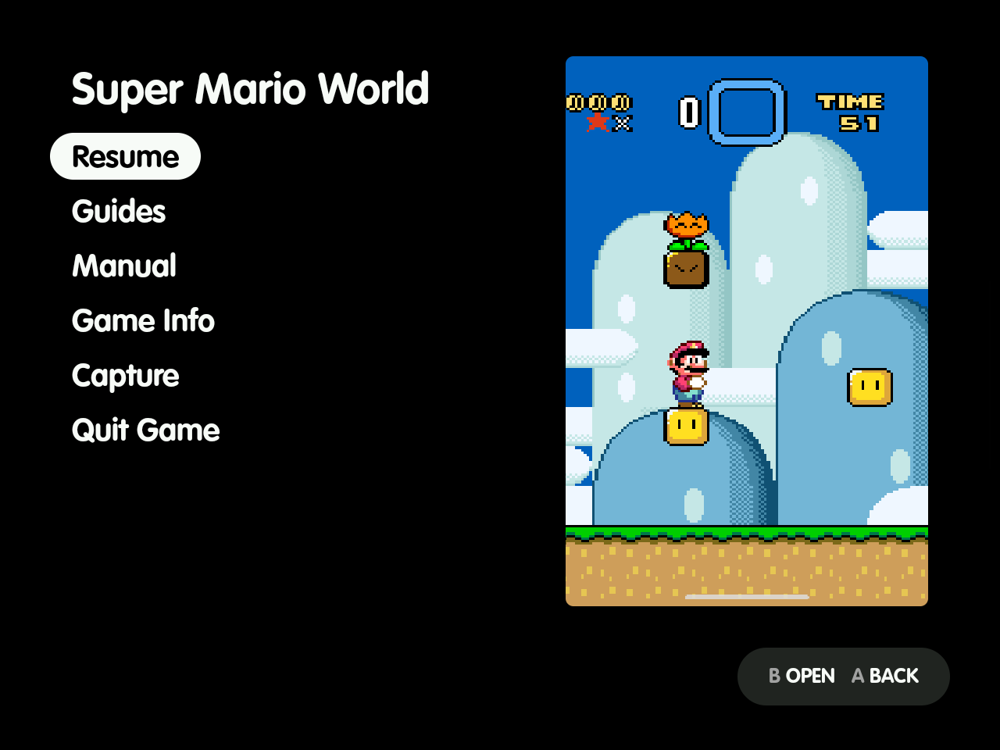

- The menu opens on **Resume**. The D-pad moves, **A** opens, and **B** closes the menu and returns to the game, as Resume does. The cursor stops at the first and last rows.
- With ES-DE's **Swap the A/B and X/Y buttons** setting on, the overlay swaps them too. The screenshots here are from a device with it on, so their hints read `B OPEN` and `A BACK`.
- **B** in any screen opened from the menu comes back to the row that opened it.
- **Back** again closes everything the menu has open, a guide or the browser too, and returns to the game.
- Home closes the menu and anything open over it, and goes to ES-DE. The game keeps running unless **Quit games left with Home** is on (see [Shizuku](shizuku.md)).
- A row too long for the list scrolls sideways a second after it's selected, as in ES-DE's gamelist.
- The game's name is in the theme's large size. Its ES-DE image (the type picked under **Screenshot media type**, PNG or JPG) fills the theme's art box on the right, with pixel art kept sharp. A game with no screenshot shows an outlined box reading `No screenshot`. The menu doesn't play the game's video.

## Capture

**Capture** opens **Screenshot**, **Video** and **Screenshot and Video**, with the cursor on Screenshot. Picking one closes the menu, then saves only what you picked:

- **Screenshot** takes the picture and stops.
- **Video** and **Screenshot and Video** record the clip (15 s unless you change **Clip length**). Press Back during the clip to stop early; leaving the game also stops and saves.

A toast and a notification name the saved files, e.g. `Saved: snes/screenshots/02) Hacks/Easyland.png, snes/videos/02) Hacks/Easyland.mp4`. The files are named exactly the way ES-DE expects, so they show up in the gamelist with no renaming:

```
<ES-DE>/downloaded_media/<system>/screenshots/<ROM subfolders>/<ROM name>.png
<ES-DE>/downloaded_media/<system>/videos/<ROM subfolders>/<ROM name>.mp4
```

System screenshots (Power + Volume down) taken during a game are filed the same way. ES-DE shows new media when you return to the gamelist; no reload is needed.

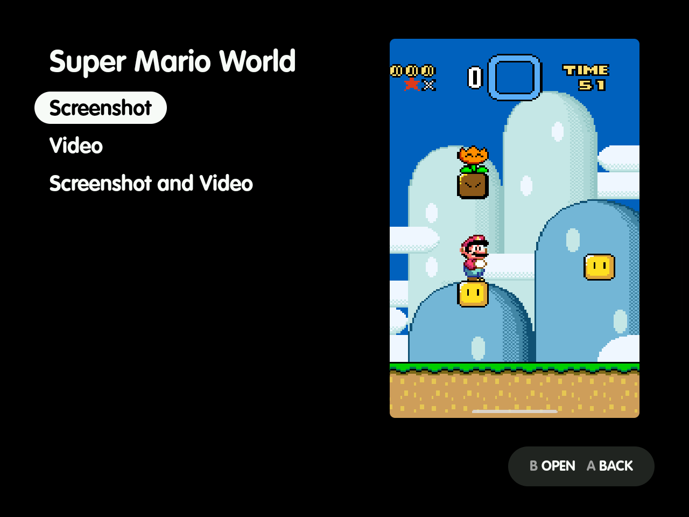

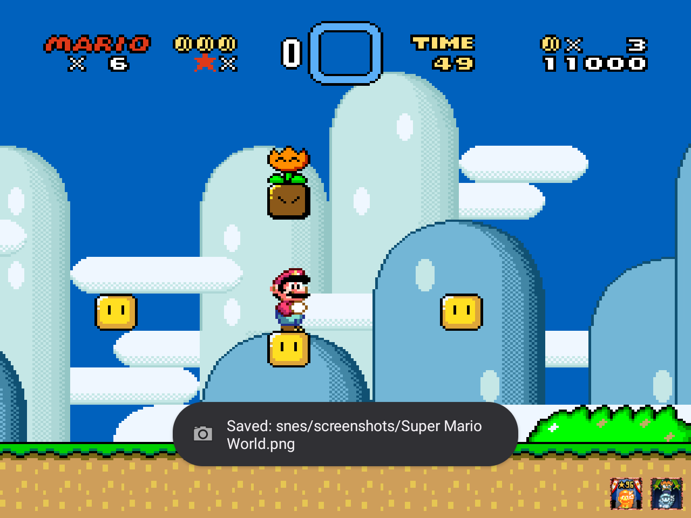

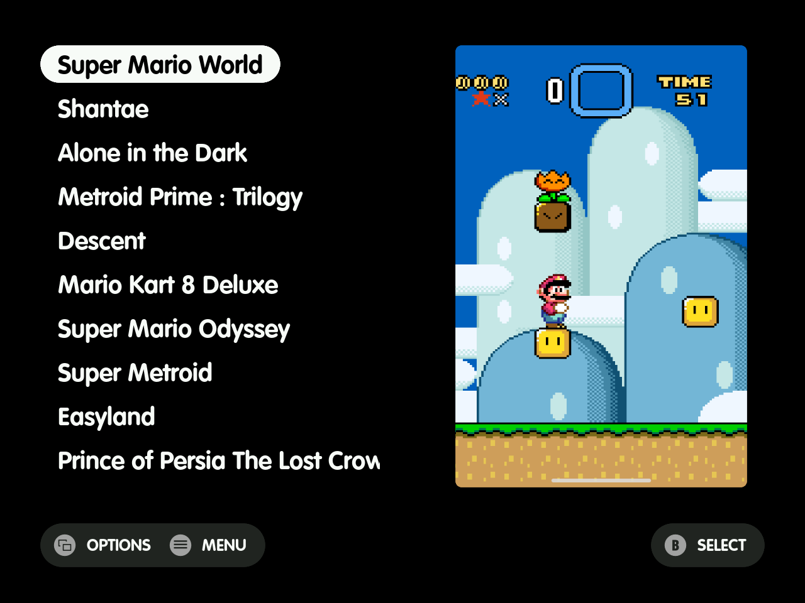

## Manual and Game Info

- **Manual** only appears when the game has one. It opens in the [viewer](#the-viewer).
- **Game Info** only appears when ES-DE's gamelist has at least one of its fields for the game. It's read-only; Up and Down scroll a long description a line at a time.
- A file that won't open shows `Couldn't open <name>` in the menu; **B** goes back.

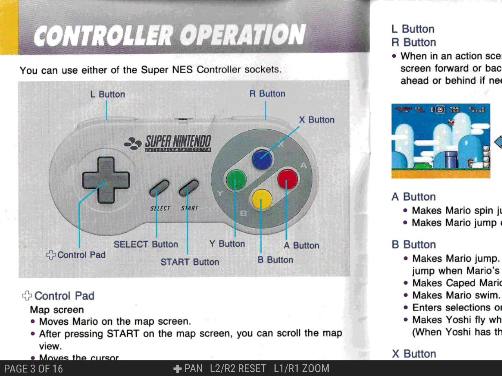

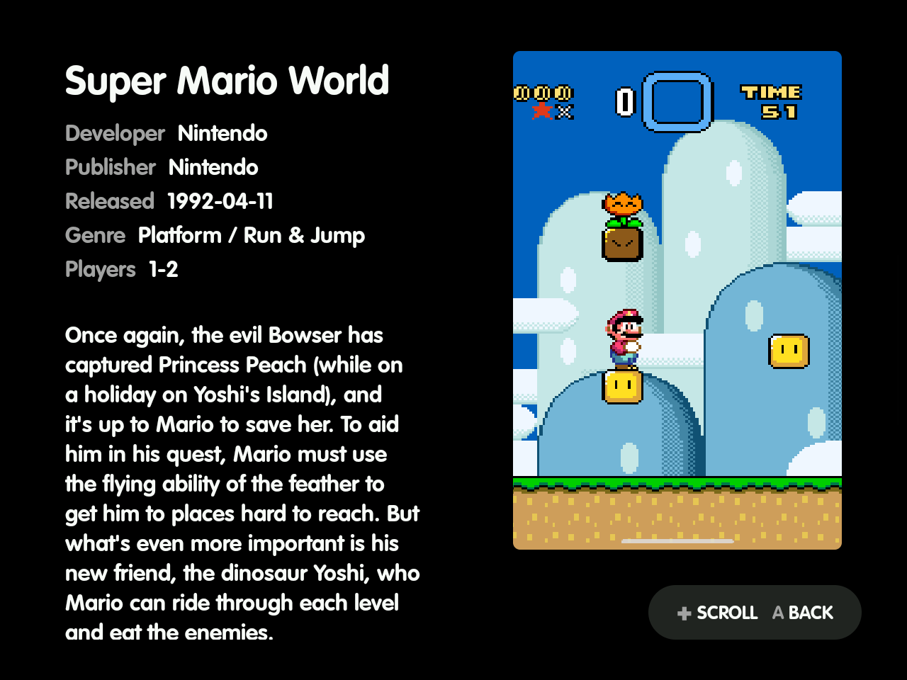

## Guides

**Guides** lists the game's guides by name, then **Find Guides**.

- **X** on a guide asks `Delete "<name>"` or **Keep**.
  - Delete removes the file, and the game's guides folder once it's empty. It then lists the guides again, or returns to the main menu, now showing Find Guides, when none are left.
  - Keep and **B** leave it.
- Every guide and manual reopens at the page or place where you left it, also after a restart. A map or manual left zoomed in reopens at the same zoom and spot, and a web or text guide at the same text size.

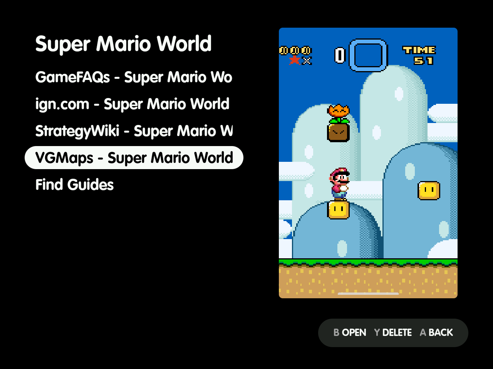

### Find Guides

**Find Guides** checks VGMaps and StrategyWiki for the game and lists the ones that have it, e.g. `VGMaps: 76 Maps` and `StrategyWiki: Super Mario World (98 Pages)`.

- Picking one saves it, with progress in the menu (**B** cancels and saves nothing), and then opens it. The main menu shows Guides from then on.
- Picking a source again replaces the saved file.
- Without a connection the menu says `Couldn't reach the guide sources`.

Below those, Find Guides always lists **Search GameFAQs** and **Search Neoseeker**. It adds **ZeldaDungeon** for a Zelda game that site has a walkthrough for. Last comes **Search the Web**, a DuckDuckGo search for "<game> guide". These sites are only contacted once you pick one.

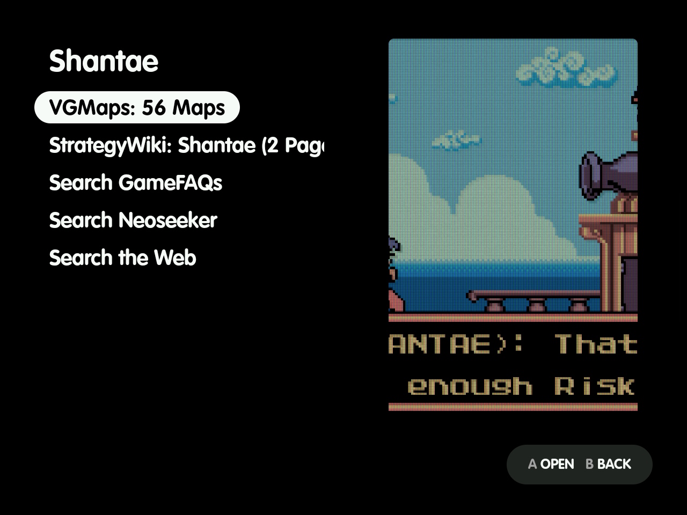

### The guide browser

Each site opens in a browser over the game, used by touch, at the site's search for the game (ZeldaDungeon at the game's walkthrough).

- Its bar has **Back**, the page title, **Save guide** on a guide's page, and **Close**.
- Tapping a text field brings up the keyboard.
- The first visit to a site may show a security check. It either clears by itself or asks you to tap "Verify you are human".

**Save guide** saves the open guide:

- A text guide saves at once.
- A guide split into pages saves by loading each page in turn in the same browser, at least 2 seconds apart, with `Saving page 3 of 8, image 12 of 40` in the bar.
- If a page shows a security check, the bar says `Clear the check to continue`, and the save waits until you have.
- **Cancel** stops and saves nothing.
- When it's done, the browser closes and the guide opens. Closing it shows the Guides list with the new guide.
- Closing the browser without saving returns to the Find Guides list.

On any other site, **Save guide** shows on pages Firefox's Reader View would offer to read. It saves the page's main content with its images, each at the largest size the page lists. A page that is mostly pictures, such as a page of maps, keeps them with their captions.

When the page links to more pages of the same guide, Save guide first lists them. Those links can be numbered pages, pages below it anywhere on the page, chapters beside it, or a Next link.

- Every page is ticked except ones that look like the site's own (contributors, edit, log in).
- Untick or tick any and tap **Save guide** again, or **Back** to return to the page.
- Next links are followed page by page, up to 50 pages.
- A listed page the site turns out not to have (it answers "not found") is left out of the save.

The site's own images, such as its logo, are left out. Links to YouTube videos are kept.

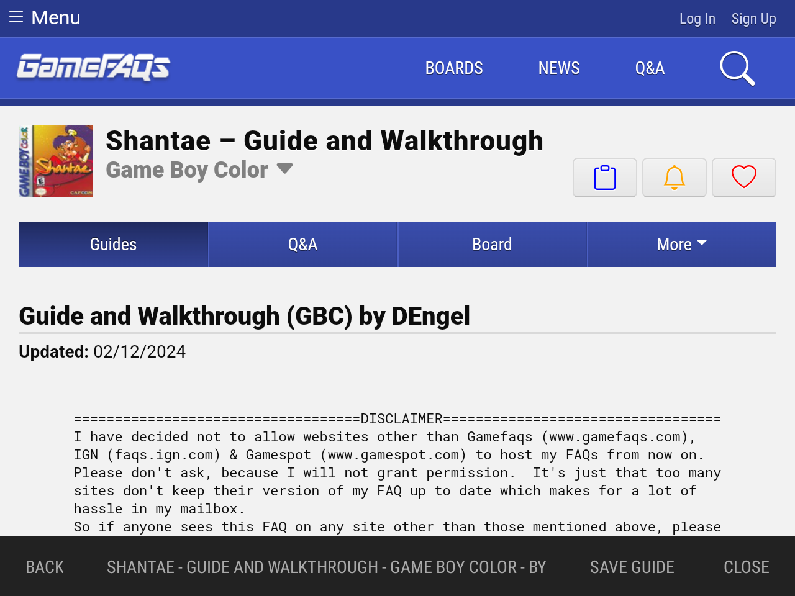

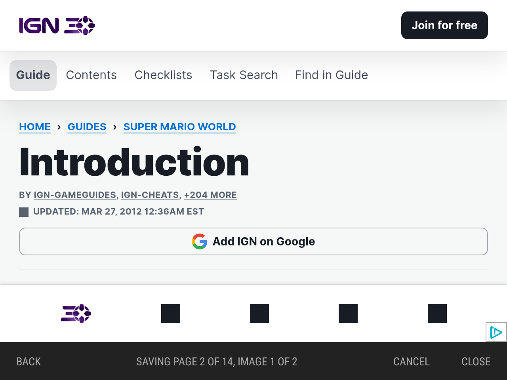

### The viewer

The viewer works like ES-DE's own manual viewer:

| | Zoomed out | Zoomed in |
|---|---|---|
| D-pad left/right | previous/next page | pan |
| D-pad up/down | — | pan |
| L1 / R1 | zoom out / in | zoom out / in |
| L2 / R2 | first / last page | reset the zoom |
| Y | maps list (CBZ) | maps list (CBZ) |
| B | close | close |

**Maps (CBZ):**

- The bar shows the page's number and name, e.g. `3 OF 9   TAIL CAVE`.
- **Y** lists the maps by name with the current one picked. The D-pad moves, L1/R1 move a screenful, L2/R2 go to the first and last map, **A** jumps to the map, and **B** or **Y** closes the list.

**Saved web guides (`.html`) and text guides (`.txt`):**

- They scroll with the D-pad (left/right by a page).
- L1/R1 change the text size, and L2/R2 move between sections.
- Above 100 %, a text guide's lines run off the right edge rather than wrap, and left/right pan the guide sideways instead (the bar shows `✚ PAN`).
- **Y** shows their contents over the guide, with the section in view picked, and works the same way as the maps list.
- While a picture is in view the bar shows `A IMAGE`. **A**, or a tap on a picture, opens it in the viewer above. There, left/right turn through the guide's other pictures, and **B** goes back to the guide where it was.
- While a link to a YouTube video is in view the bar shows `A VIDEO`. **A**, or a tap on the link, plays it in the guide browser over the guide. There, **A** pauses (the first press unmutes), D-pad left/right skip ten seconds, and **B** goes back to the guide where it was.
- Otherwise **B** first steps back through tapped links, then closes.

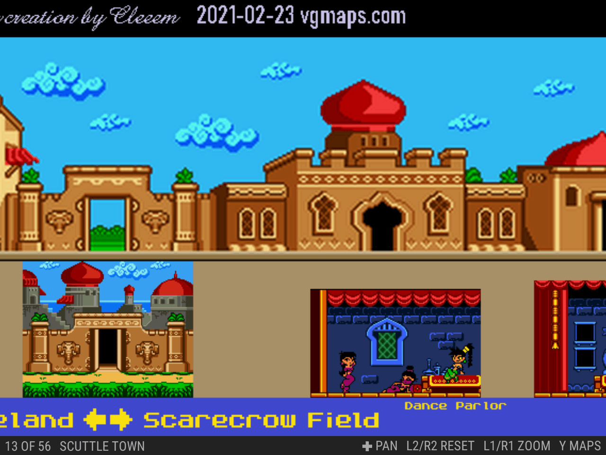

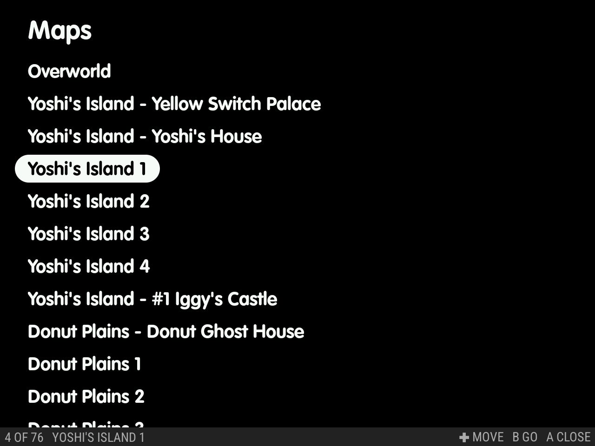

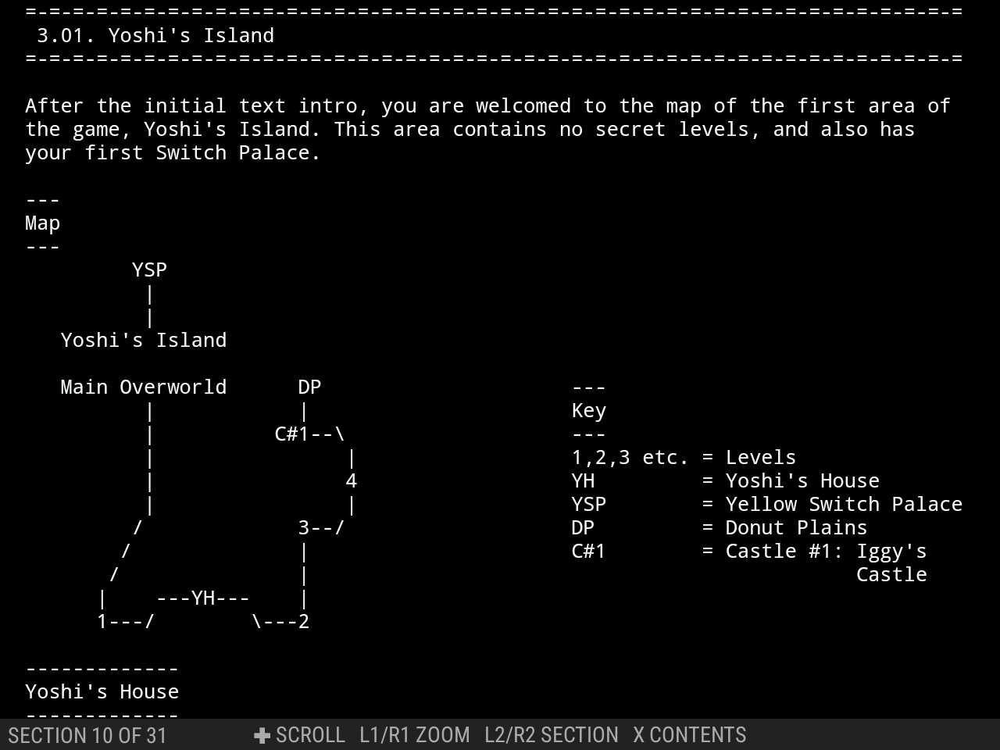

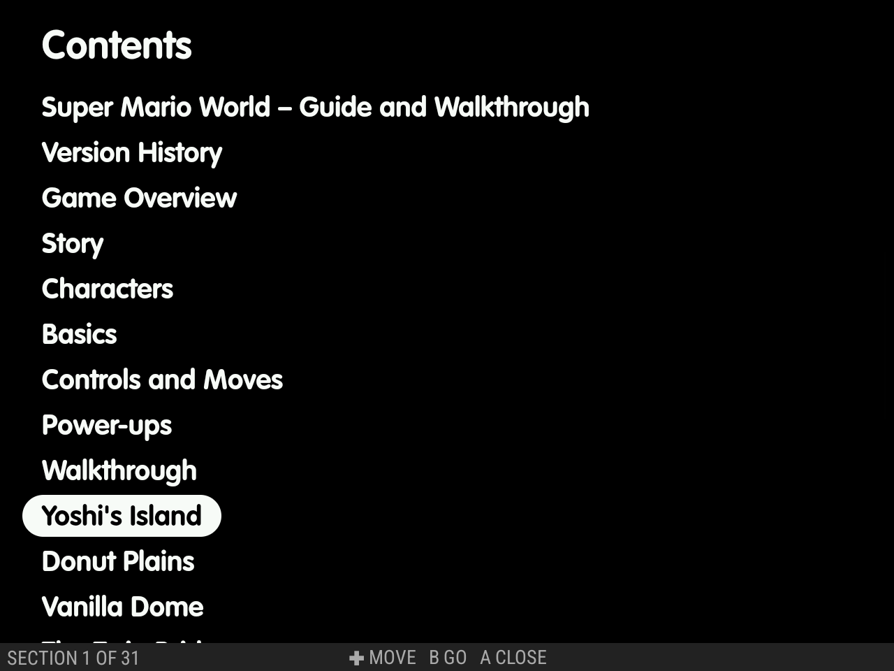

### Where guides are kept

Add guides next to ES-DE's other media, named like the ROM, or let **Find Guides** save them there:

```
<ES-DE>/downloaded_media/<system>/guides/<ROM subfolders>/<ROM name>.<ext>
<ES-DE>/downloaded_media/<system>/guides/<ROM subfolders>/<ROM name>/<any name>.<ext>
```

- The folder form holds several guides.
- Supported:
  - `pdf`;
  - `txt` (UTF-8; ASCII art keeps its columns);
  - `png`, `jpg`/`jpeg` (large maps are decoded a region at a time);
  - `cbz`;
  - `html`.
- Not supported: `cbr`.
- A ROM that is a folder (e.g. `dig.scummvm`) keeps its whole name, as for ES-DE's own media.

Find Guides saves into the folder form, for example:

```
<ES-DE>/downloaded_media/snes/guides/Super Mario World/VGMaps - Super Mario World.cbz
<ES-DE>/downloaded_media/snes/guides/Super Metroid/StrategyWiki - Super Metroid.html
<ES-DE>/downloaded_media/snes/guides/Super Mario World/GameFAQs - Super Mario World – Guide and Walkthrough by Crazyreyn.html
```

What each kind of save holds:

- **VGMaps:** one CBZ of the game's maps in the atlas's order, each named as the atlas names it (`003 Tail Cave.png`).
- **StrategyWiki:** one HTML file. It has a contents list, one section per wiki page, its images inside the file, and the source and licence (CC BY-SA 4.0) at the end.
- **From the browser:** the same kind of HTML file. A text guide is kept as fixed-width text, and a guide in pages gets one section per page with its images inside.

How text guides are split into sections:

- This applies to saved text guides and `.txt` files alike.
- They're split at their headings: where the contents list's tags (`[INTRO]`, `(B)`, `1.`) start a line further down.
- Failing that, they're split at lines boxed or underlined with `=`, `-`, `*`, `#`, `~` or `_`.
- Text guides saved before this version are split when they open.

Site scripts, ads and comments are left out, and the end names the source page and author. These guides belong to their authors; save them for your own reading. The viewer shows saved guides offline in the theme's colours and font. Opened anywhere else, they're plain web pages.

### Manage Guides

**Saved guides → Manage Guides** in settings lists every saved guide by game, with the total on top. Each game is listed under its ES-DE name with its system, guide count, size and last played date.

- Search finds a game by name (**✕** clears it).
- **Size** (largest first), **Last Played** (oldest first, never played before that) and **Name** sort the list.
- A game whose ROM is no longer in the ROMs folder reads *ROM missing*.
- Open a game to see its guides and their sizes:
  - **Delete** removes one guide, and **Delete All** removes all of the game's guides, each after a confirm (**Keep** leaves them).
  - Deleting a game's last guide also removes its emptied `<ROM name>/` folder.
- The screen reads the guides from `downloaded_media` each time it opens.

## Quit Game

**Quit Game** (the last row) ends the game's app at once, with no confirmation, and ES-DE comes back.

- With [Shizuku](shizuku.md), nothing else shows. Without it, the game's App Info page shows for a moment.
- It works for any game ES-DE launched, emulator or Android game.
- It closes without warning. Your saves are kept, but progress since your last save is lost, and an emulator's save-on-exit doesn't run. (On the Nova it was tested on, RetroArch writes in-game saves every 10 s.)
