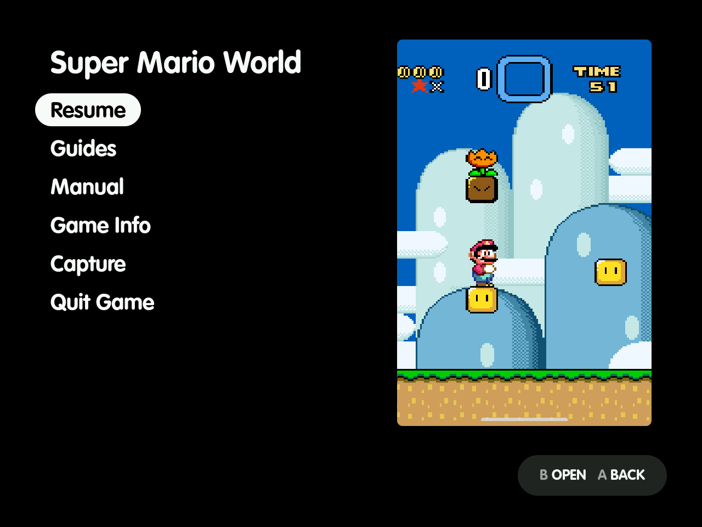
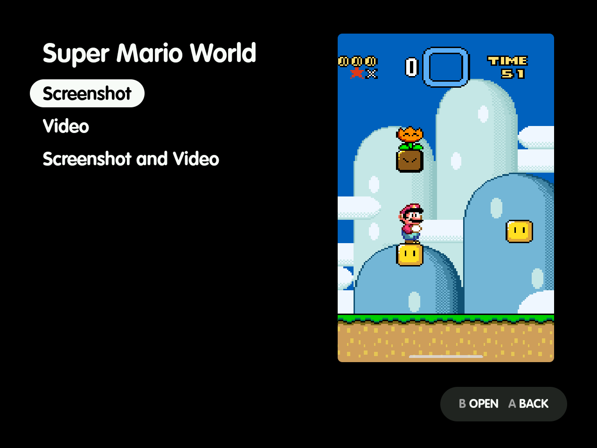
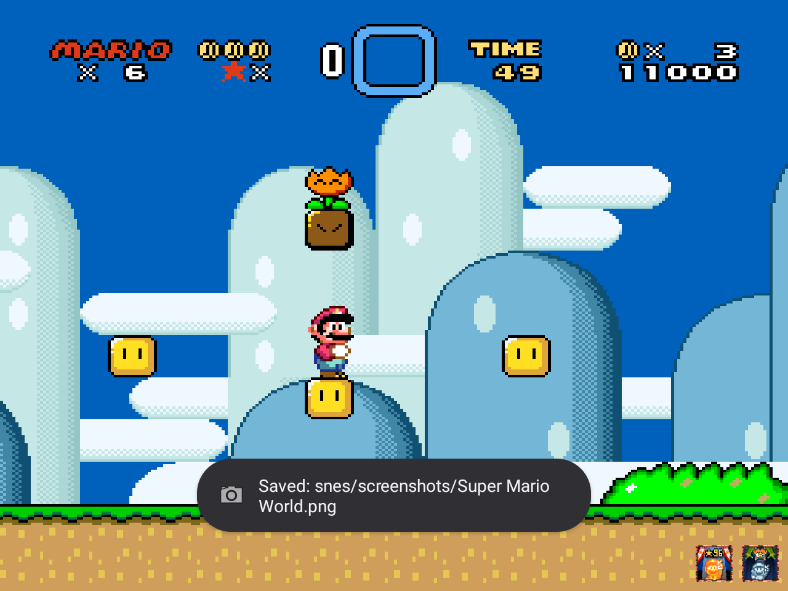
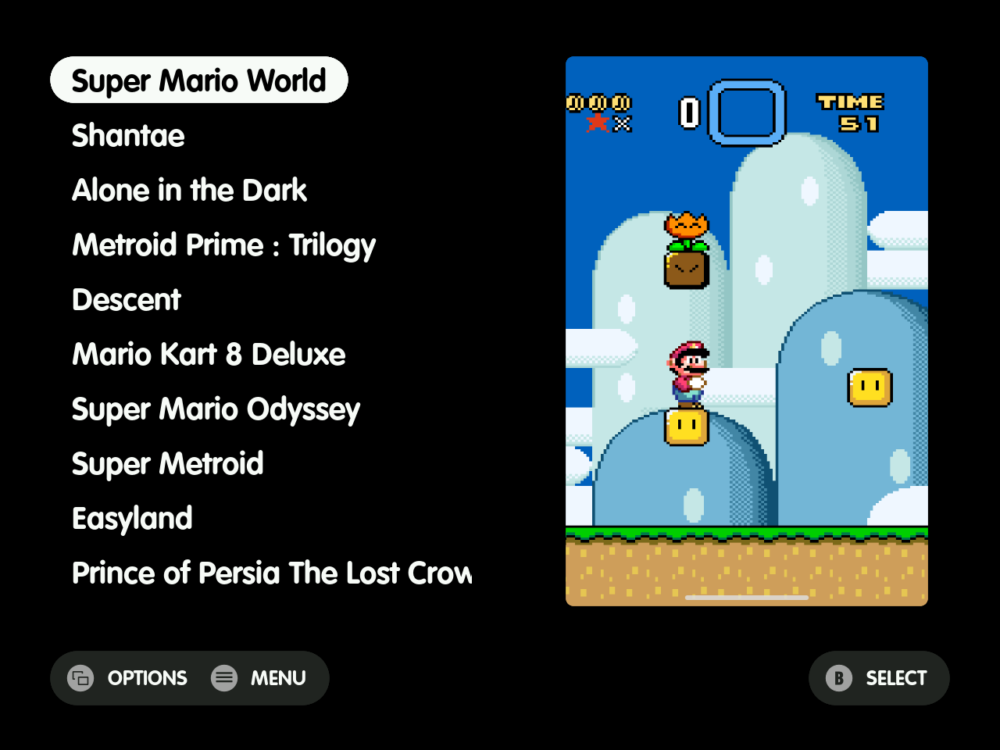
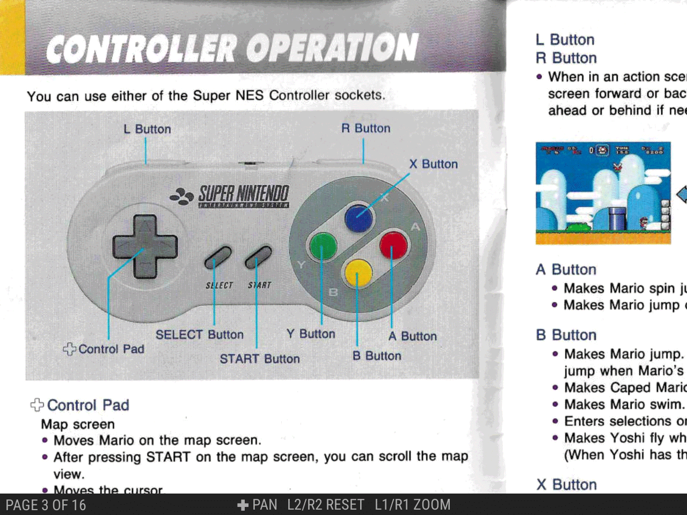
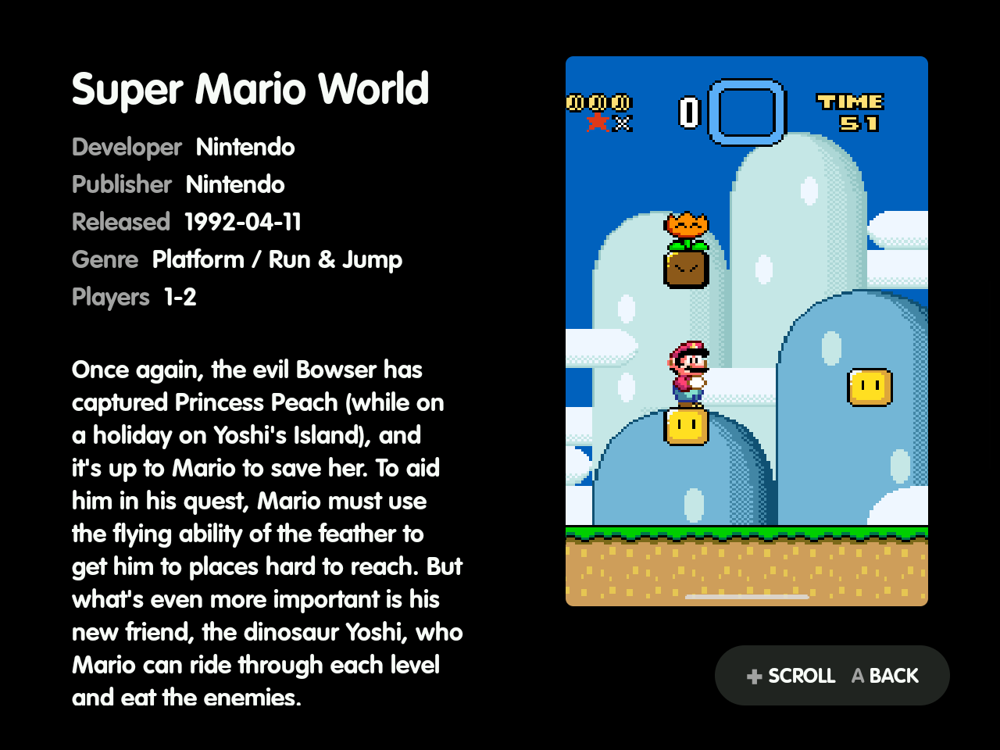
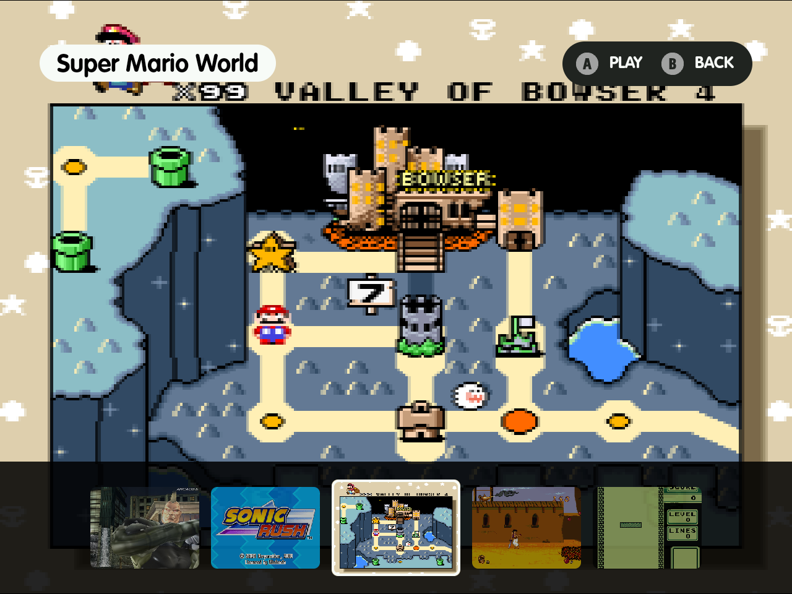
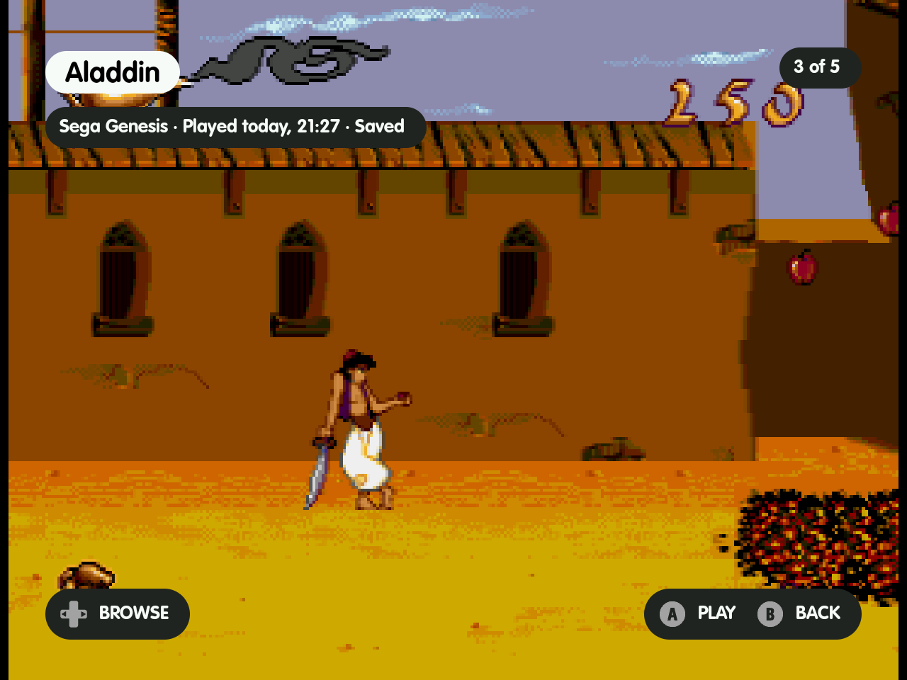

---
---

# Use

## The menu

Launch a game from ES-DE and press **Back** or **Menu** on your controller: the Android Back button beside Home on Retroid and AYN handhelds, or Menu on controllers that have one. You can choose another button under **Controls** in settings, or pull down the notification shade, expand ES-DE Overlay's notification and tap **Open Menu**. The menu opens over the game in your ES-DE theme's look (see [Theme](theme.md)). You'll see the game's name, its picture from ES-DE, and these rows:

- **Resume** closes the menu and takes you back to the game.
- **Guides** lists the game's guides (see [Guides](guides.md)), with **Find Guides** last. A game with no guides shows **Find Guides** here instead.
- **Manual** opens the game's scraped ES-DE manual.
- **Game Info** shows the game's developer, publisher, release date, genre, players and description from ES-DE's gamelist.
- **Capture** saves a screenshot, a clip, or both, into ES-DE's media folders.
- **Quit Game** ends the game's app and takes you to ES-DE.



- Use the D-pad to move, **A** to open, and **B** to close the menu and go back to the game. Up on the first row goes to the last, and Down on the last goes to the first. A held D-pad stops at the end. If ES-DE's **Swap the A/B and X/Y buttons** setting is on, the app swaps them too. The screenshots here were taken with it on, so their hints read `B OPEN` and `A BACK`.
- **B** in any screen you opened from the menu takes you back to the row that opened it. The guide browser is the exception, because you use it by touch.
- The menu button again closes everything the menu has open, a guide or the browser included, and takes you back to the game.
- Once you've opened a guide, map or manual for a game, the menu button opens straight into it, at your place, and **B** goes back to the menu. See [Guides](guides.md).
- Pressing Home closes the menu and anything open over it, and takes you to your Home app. The game keeps running unless **Quit games left with Home** is on (see [Shizuku](shizuku.md)), which works only when ES-DE is your Home app. With it on, a RetroArch game is closed through RetroArch's own *Quit* hotkey, as [Quit Game](#over-a-retroarch-game) does.
- Opening the menu pauses RetroArch on the Nova. Other emulators and Android games may keep running behind it.

A few details:

- The picture is the game's ES-DE image of the type picked under **Menu image** in settings, which follows **Screenshot media type** unless you change it (PNG or JPG), with pixel art kept sharp. Screenshots and title screens fill the box; other images, such as covers, are scaled to fit. A game without one shows an outlined box reading `No screenshot`. The menu doesn't play the game's video.
- A row too long for the list scrolls sideways a second after you select it, as in ES-DE's gamelist.

## Capture

**Capture** offers **Screenshot**, **Video** and **Screenshot and Video**. Pick one and the menu closes so it isn't in the shot. Only what you picked is saved.

The first time you pick one after the service starts, Android asks for permission to capture the screen. Tap **Start now**, then pick **Capture** again: the first pick only gets the permission, and a message says so. Eden pauses behind Android's question and stays paused: tap its play button to resume the game first. The permission lasts until the service or the device restarts. If you leave the game while Android is asking, Android closes its question.


- **Screenshot** takes the picture and stops.
- **Video** and **Screenshot and Video** record a clip (15 s unless you change **Clip length**). Press the menu button to stop early. Leaving the game also stops the clip and saves it.

Over a RetroArch game with a shader on, the app turns the shader off for the screenshot or clip and back on afterwards, so captures show the game without scanlines or a mask. It does this by pressing RetroArch's *Shaders (Toggle)* hotkey, which needs [Shizuku](shizuku.md) and the hotkey on a controller button (see [RetroArch hotkeys](setup.md#retroarch-hotkeys)). Without them, the capture shows the shader as before.

A toast and a notification name the saved files, for example `Saved: snes/screenshots/02) Hacks/Easyland.png, snes/videos/02) Hacks/Easyland.mp4`. A file that took the place of one the game already had is listed first, under `Replaced:`. A long list is cut short in the toast; the notification has all of it. They're saved as:

```
<ES-DE>/downloaded_media/<system>/screenshots/<ROM subfolders>/<ROM name>.png
<ES-DE>/downloaded_media/<system>/videos/<ROM subfolders>/<ROM name>.mp4
```

ES-DE shows new media when you go back to the gamelist, so you don't need to reload it.

When the game already has that image or clip, **If the media file already exists** in settings decides what happens:

- **Replace** (the default) puts the new capture in its place. The new file is written beside the old one and swapped in only once it's complete, so a capture that fails leaves the old file as it was.
- **Ask** opens the menu again once the capture is done, with **Keep Existing** selected and **Replace Screenshot** or **Replace Video** below it. **B**, the menu button or leaving the game keeps the existing file.
- **Skip** keeps the existing file and drops the new capture.

Turn on **Use system screenshots as game images**, under **Capture** in settings, and the system screenshots you take during a game are saved the same way: Power + Volume down, or the Screenshot tile in quick settings. (On the Nova it was tested on, Power + Volume down doesn't take one; the tile does.) It's off by default and needs the **Read screenshots** permission. Android keeps its own copy in Screenshots either way. Under **Ask**, a system screenshot keeps the existing file, because there's no menu open to ask in.







## Manual and Game Info

- **Manual** appears only when the game has one, and opens it in the [viewer](guides.md#the-viewer).
- **Game Info** appears only when ES-DE's gamelist has at least one of its fields for the game. Press Up and Down to scroll a long description a line at a time.





## Guides

The menu's **Guides** row lists the guides you've saved for the game, and **Find Guides** saves new ones from guide sites. They have their own page, [Guides](guides.md):

- <a id="find-guides"></a>[Find Guides](guides.md#find-guides)
- <a id="the-guide-browser"></a>[The guide browser](guides.md#the-guide-browser)
- <a id="the-viewer"></a>[The viewer](guides.md#the-viewer)
- <a id="where-guides-are-kept"></a>[Where guides are kept](guides.md#where-guides-are-kept)
- <a id="manage-guides"></a>[Manage Guides](guides.md#manage-guides)

## Quit Game

**Save first.** For every game but a RetroArch one set up as below, Quit Game force-closes the game's app, so anything not yet written to storage is lost and save-on-exit doesn't run. (On the Nova it was tested on, RetroArch writes in-game saves every 10 s.)

**Quit Game** (the last row) ends the game's app, then takes you to ES-DE: it presses Home when ES-DE is your Home app, and otherwise brings ES-DE back to the front.

- To have it ask first, turn on **Confirm before quitting** under **Quitting games** in settings. The question opens on **Keep Playing**: **A** there, or **B**, takes you back to the menu, and **Quit "*game name*"** ends the game.
- With [Shizuku](shizuku.md), nothing else shows. Without it, the game's App Info page shows for a moment.
- It works for any game ES-DE launched, emulator or Android game.

### Over a RetroArch game

With [Shizuku](shizuku.md) and RetroArch's *Quit* hotkey on a controller button (see [RetroArch hotkeys](setup.md#retroarch-hotkeys)), Quit Game presses that hotkey instead of force-closing RetroArch, so RetroArch closes as it does when you press it yourself.

- With RetroArch's *Auto Save State* on, it saves its auto state as it closes. With *Auto Load State* on too, the game starts there next time.
- If RetroArch is still running 5 s later, it's force-closed as before.
- **Home** does the same when **Quit games left with Home** is on: the app presses the hotkey as you let go of Home, so what you played isn't lost. With that setting off, Home leaves RetroArch running, as before.
- Other emulators are force-closed as before, by Quit Game and by Home.

## Game Switcher

Turn on **Switch games from ES-DE**, under **Game Switcher** in settings, and the menu button in ES-DE lists the games you played last, newest first. It's off by default, and it needs [Shizuku](shizuku.md) and four ES-DE settings: [Set up](setup.md#game-switcher) lists them. Until every line of its checklist is ticked, ES-DE keeps its button.

- **Left** and **Right** move between games, **A** picks one and **B** closes the switcher.
- Pick a game and ES-DE starts it. The game's picture stays on screen while the app sends ES-DE the key presses that move its own lists to that game and launch it, so the launch is ES-DE's own. Leave the D-pad alone until the game starts.
- It opens only with ES-DE in front, not during a game.
- It's drawn in your ES-DE theme's colours and font, as the menu is (see [Theme](theme.md)), and follows a theme change as soon as ES-DE's menu closes.
- If ES-DE can't be moved to the game, the switcher closes with a `Couldn't reach <game> in ES-DE` message and nothing is launched.

Under **How the switcher shows the games**, pick a layout:

- **Strip of Recent Games** (the default) shows the selected game's picture with its neighbours' pictures in a strip along the bottom.
- **One Game a Screen** shows one game's picture as large as the screen allows.





**Games the switcher shows, newest first** runs from 5 to 50 in steps of 5 (default 10). **Show each game's system and when it was played** (off by default) adds a line under the game's name, such as `Nintendo SNES (Super Nintendo) · Played today, 13:04 · Saved`.

### The pictures

Each game shows where you left it, when the app has a picture of that:

1. If the emulator is set to start the game from a save state, that state's picture. This is RetroArch with *Auto Load State* on, or PPSSPP with its auto-load setting on (`AutoLoadSaveState` not `0` in `ppsspp.ini`).
2. Otherwise, the newer of a save state's picture and the picture the app kept when you quit the game.
3. Otherwise, the game's scraped ES-DE image.

With the detail line on, it ends in *Saved* for a save state's picture and *Left* for a kept one.

- **Save-state pictures** show for RetroArch, PPSSPP and ARMSX2. RetroArch writes them only with *Save State Thumbnails* on (see [Set up](setup.md#game-switcher)). Other emulators' games show the kept picture or the scraped image; [Known limitations](limitations.md#game-switcher) says why.
- **A kept picture** is taken by **Keep a picture of where you left a game** (on by default): Quit Game, and Home when it ends the game, take a picture of the game's screen first. It's only a picture. The game doesn't start from there unless the emulator saved as well.
- **RetroArch's pictures have no shader.** A save state's picture is the game's own frame, and a kept one is taken with the shader turned off, through the *Shaders (Toggle)* hotkey. With RetroArch's *Auto Save State* on and its *Quit* hotkey set up, the app keeps no picture of its own, because the auto state's picture is the game's.
- **RetroArch's save-state pictures show at the shape RetroArch shows the game**, following its aspect ratio setting, its core, folder and game overrides, and the core's own aspect option.

### Coming back from a game

- After a game you picked in the switcher ends, or you leave it with Home, the switcher opens again over ES-DE on that game. Its old picture shows with *Updating* over it until the new one is read. There's no setting for this.
- A game you launched from ES-DE's own list doesn't bring the switcher up.
- ES-DE can't launch a game in a RetroArch that's still running another: RetroArch quits instead. When that happens to a pick from the switcher, the app presses the launch once more, and the game starts.
- Left alone, the switcher closes once ES-DE's screensaver has started, so the screensaver shows. The menu button opens it again. While you're using it, it stays open.
